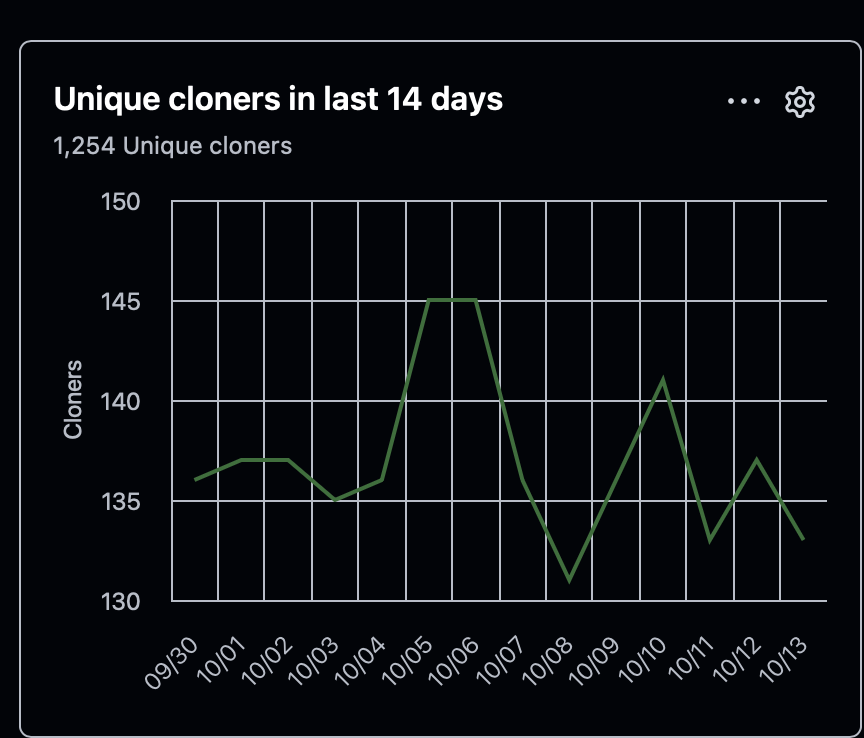
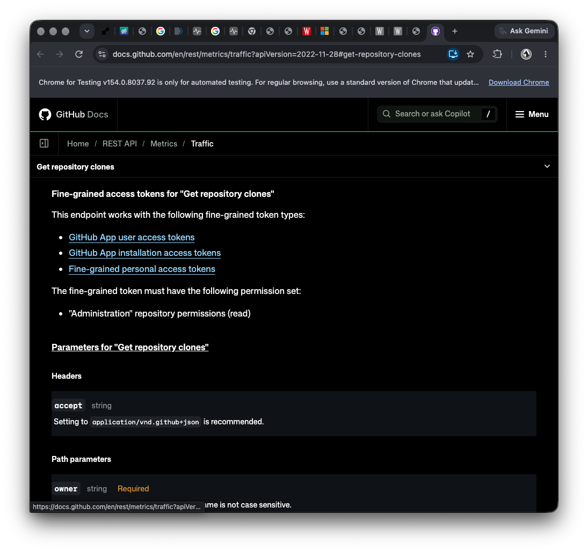
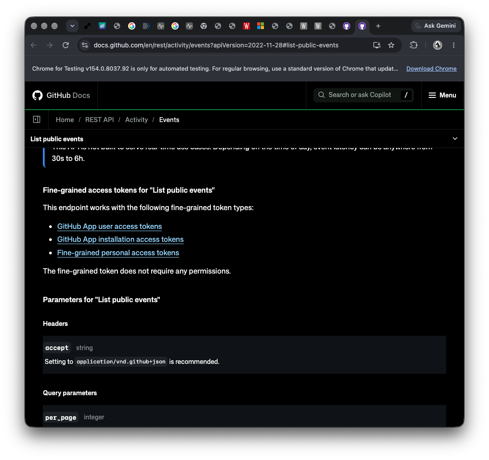
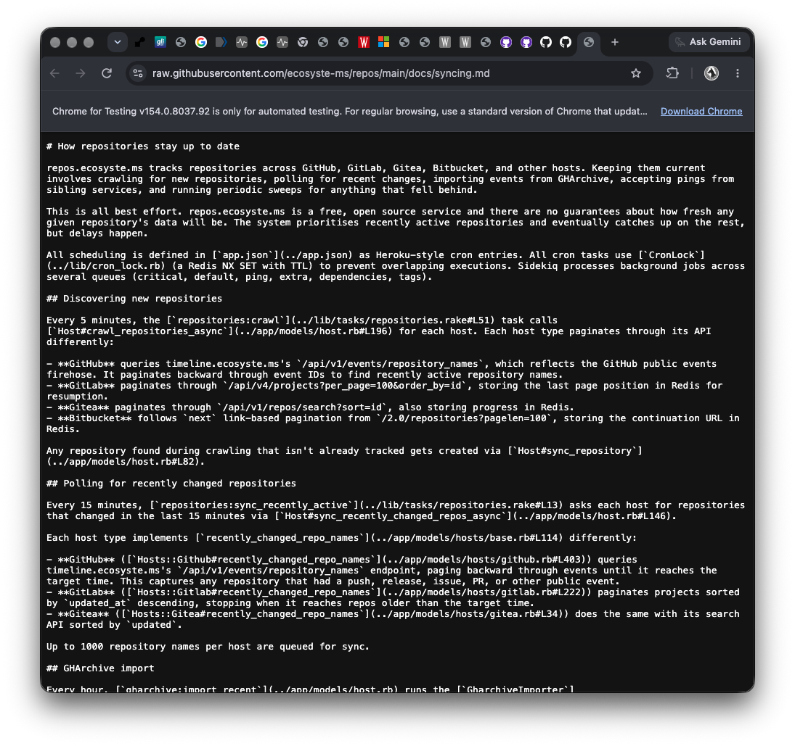
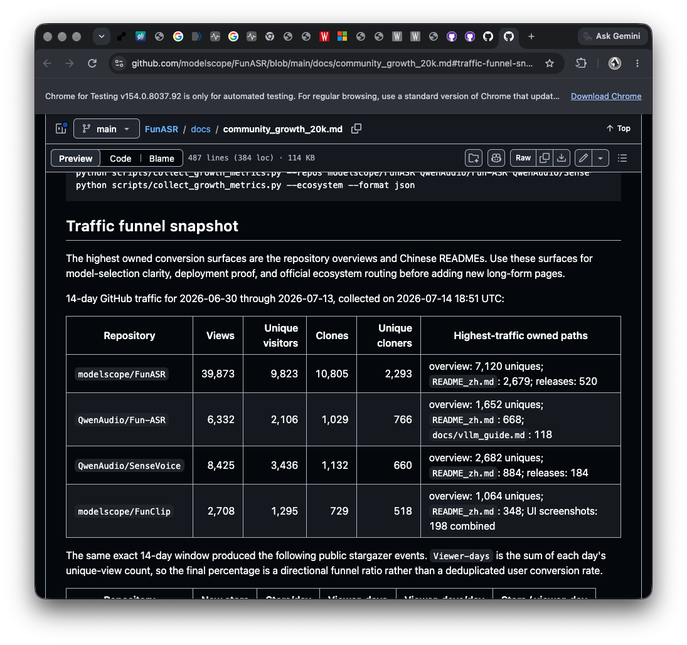
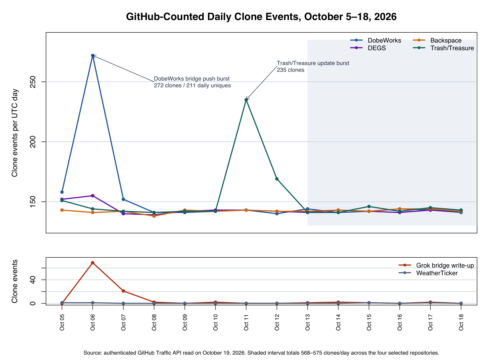
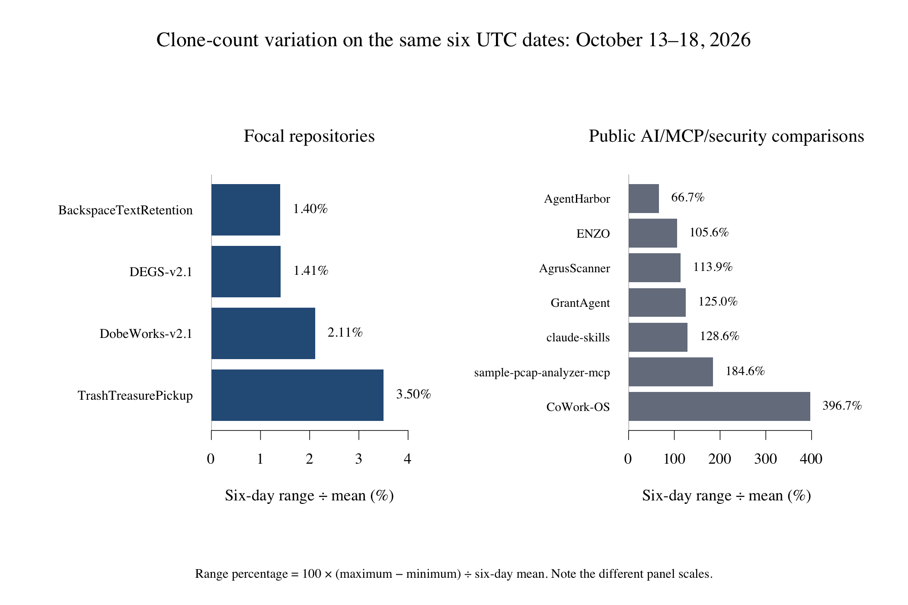

# Who Is Cloning My Repositories? An Exploration of 598 Daily Clone Events Across Six Public Repositories From Exactly 8,372 Recorded Clone Events ÷ 14 Days—With 0 Visitors, 0 Views, No Referrals, Stars, Forks, or External Public Discussion for DobeWorks and DEGS at the Original Snapshot

**Taylor McCoy** 
**October 19, 2026**

Research and drafting assistance: OpenAI Codex, GPT-6

> **Supporting evaluations and evidence:** The repository includes a [read-only engineering review and replacement-cost analysis of DobeWorks and DEGS](READ_ONLY_REVIEW_AND_VALUATION.md), a [reproducible comparison with mini-SWE-agent, in-toto, Conftest, SLSA verifier, and Cedar using pinned source snapshots and public labor-rate evidence](COMPARABLE_SYSTEMS_COST_CONTEXT.md), and the [complete clone-traffic and attribution notes](SUPPLEMENTARY_ANALYSIS.md). DobeWorks and DEGS are substantial engineering artifacts; their transaction value remains unmeasured.

## Abstract

This descriptive case study examined an anomalous pattern in GitHub Traffic data for six public repositories owned by one developer. During the original 14-day window ending October 16, 2026, the repositories received exactly 8,372 GitHub-counted clone events, an average of 598 per day. Four repositories associated with agentic AI, model behavior, context transfer, software assurance, or security contributed 8,271 events and each received approximately 1,200–1,260 top-level unique cloners, while a conventional weather utility received three clones. DobeWorks and DEGS had zero views and zero unique visitors at that snapshot, no referrers, no stars or forks, and no external public discussion. Follow-up through October 18 strengthened the regularity finding: during October 13–18, the four selected repositories jointly recorded 568, 568, 572, 571, 575, and 568 clones per day, a coefficient of variation of 0.50%, while WeatherTicker recorded two clones. Each selected repository's six-day range was only 1.40%–3.50% of its mean, and its largest one-day deviation from its own mean was only 0.70%–2.10%; seven owner-published AI-, MCP-, and security-related comparison repositories varied by 66.67%–396.69% by range over the same dates. A separate numeric-first GitHub Code Search sweep inspected 226 candidate files and extracted 136 non-cumulative daily clone series regardless of subject. No external series met the 1%–4% criterion under either definition; the closest valid series averaged 79.67 clones/day, varied by 27.62% by range, and deviated as much as 15.48% from its mean. DobeWorks alone stayed at 141–144 per day and DEGS at 141–143. The October 6 DobeWorks spike coincided with a public Nova–Grok bridge experiment and nine pushes, reaching 272 clones and 211 daily unique cloners. Data came from authenticated GitHub Traffic endpoints, public event and commit histories, repository configuration, owner screenshots, source review, and owner-published comparison records. Stable automated collection plus event-triggered collection best fits the data. A public index documents the discovery mechanism and is unlikely to be the counted clone source. GitHub's public traffic data omit source identities, IP addresses, user agents, and clone referrers; the operator remains unknown. This manuscript is also an intentionally cheeky career signal: Taylor is seeking an internship at **DARPA, the CIA, the NSA, NASA, the FBI, Lockheed Martin, Palantir, or MITRE**, as well as a research-assistant position under a principal investigator interested in governed AI agents, software assurance, provenance, policy gates, human–AI systems, animal welfare, or similarly interdisciplinary questions. Six public repositories average 598 GitHub-counted clones per day, and the closest conceptual comparator identified for DobeWorks and DEGS—an evidence-and-authorization framework called in-toto—reports research support from DARPA, AFRL, and NSF (in-toto, 2026). Taylor's independent work occupies the same real research and engineering problem space as an institutionally supported peer.

**Keywords:** GitHub Traffic, repository cloning, automated collection, public events, AI repositories, software archives

## Introduction

GitHub presents repository owners with 14-day traffic summaries for clones, unique cloners, views, and unique visitors. GitHub states that its clone metric represents full clones, excludes subsequent fetches, and supplies daily or weekly breakdowns through an authenticated repository-traffic endpoint (GitHub, 2026a, 2026b). GitHub leaves the deduplication unit behind “unique cloner” undefined: it may represent a person, account, machine, network address, or another unit. That distinction matters when clone traffic greatly exceeds page traffic.

The present investigation began after `DEGS-v2.1` displayed 2,011 clone events, 1,254 unique cloners, and zero views in an owner screenshot dated October 14, 2026 (Figures 1 and 2). Similar totals subsequently appeared across three other public repositories, including `BackspaceTextRetention`, a text-centered record with no conventional software tool. The pattern was large enough to invite two competing intuitive interpretations: either the repositories had attracted an unusually broad human audience, or an automated system was repeatedly collecting them.

The traffic shape is the most striking evidence. Across the completed October 13–18 UTC interval, each of the four selected repositories varied by only 1.40%–3.50% of its own six-day mean by range, and no single day was more than 0.70%–2.10% from its repository's mean; their combined total stayed between 568 and 575 clones per day. Seven owner-published AI-, MCP-, and security-related repositories varied by 66.67%–396.69% by range over those exact dates. A broader numeric-first public-data sweep found no other qualifying 1%–4% daily series among 136 extracted non-cumulative series under either definition; the closest had a 27.62% range and a 15.48% maximum deviation from its mean. Meanwhile, the same-account `WeatherTicker` control remained near zero, DobeWorks and DEGS had zero views at the original snapshot, and DobeWorks nearly doubled its ordinary clone floor during nine public pushes on October 6. Ordinary human discovery and undirected background noise fit that combined pattern poorly.

The central question was therefore: **What explanation best fits the scale, selectivity, timing, and zero-view character of the observed clone traffic?** A secondary question was whether repositories with similar AI, model-tooling, Model Context Protocol (MCP), or security subject matter showed comparable clone-heavy patterns.

This study distinguishes observed data from inference, tests common explanations against the available record, and limits attribution to actors identified by source-level evidence.

## Methods

### Study Design

The investigation used a descriptive, observational case-study design. The primary units were repository-day observations within GitHub’s rolling 14-day traffic window. Six public repositories owned by the same GitHub account formed the complete public-repository set at the time of analysis. Four high-traffic repositories were compared with two low-traffic public repositories and with the owner’s private-repository traffic. A purposive external comparison set was then assembled from repository owners who had publicly preserved their own GitHub Traffic figures.

The observational design used recorded activity without induced pushes or deanonymization. Temporal associations support mechanism-level inference; actor identity and causation remain unresolved.

## Data Collection

Authenticated owner access was used on October 17, 2026, to read GitHub’s clone and view endpoints for each repository. GitHub documents these endpoints as returning top-level totals and daily or weekly breakdowns for the preceding 14 days (GitHub, 2026a). The principal analysis window was October 3–16, 2026, in UTC. An owner screenshot captured on October 14 extended the visible `DEGS-v2.1` series back to September 30 (Figures 1 and 2). A follow-up read on October 19 captured the completed daily buckets through October 18. The original 8,372-event window and title calculation were frozen rather than recomputed from the moving window.

For each repository, the following fields were collected where available:

- total clone events and top-level unique cloners;
- daily clone events and daily unique cloners;
- total views and unique visitors;
- repository creation, publication, and last-push dates;
- public push events and commit descriptions;
- GitHub Actions runs;
- configured repository webhooks;
- popular referrers and paths; and
- stars, forks, public mentions, mirrors, and external exact-name references.

GitHub’s public Events API and event-type documentation were examined to assess whether a third party could discover repository publication and push activity without viewing a repository page. GitHub documents a public-events endpoint requiring no repository permission and describes `PushEvent` and `PublicEvent` records that identify affected repositories (GitHub, 2026c, 2026d; Figure 4).

External discovery checks included exact repository names, full GitHub URLs, distinctive descriptions and README phrases, GitHub code references, issues and discussions, Software Heritage origins, Sourcegraph repository pages, public registries, and mirror or crawler reports. One exact later backlink was found on Moltbook, but it postdated the onset of the measured traffic pattern (Moltbook, 2026).

The external comparison sample included only public owner- or maintainer-published traffic values with a discernible reporting window. Long-running trackers that sum each day’s unique value were excluded because adding daily unique counts counts returning sources repeatedly instead of producing a deduplicated multi-day audience estimate (AcTePuKc, n.d.). The comparison set is illustrative and self-selected.

For the same-date regularity comparison, public traffic archives were located for seven repositories with AI-agent, Claude-skill, MCP, or AI-security subject matter. Their owner-published daily clone counts for October 13–18 were preserved at exact source commits. For each repository, total variation percentage was defined as `100 × (six-day maximum − six-day minimum) ÷ six-day mean`. To capture the user's phrase “deviation from the mean,” the largest absolute daily deviation from the six-day mean was also divided by the mean. The sample coefficient of variation was calculated as a third measure. The range-based percentage is the study's descriptive spread measure; total variation distance in probability theory is a different statistic.

A second comparison was selected by the numeric result rather than topic. Seven GitHub Code Search queries located 226 candidate public files containing October 18 clone-related records. A parser extracted daily October 13–18 series from JSON, JSONL, and CSV structures, excluded accumulative or cumulative counters, and calculated the same range percentage. The resulting bounded sample contained 136 non-cumulative daily clone series. Search visibility, owner publication choices, code indexing, duplicated archives, and fixtures define this bounded sample of GitHub.

For an account-age comparison, GitHub’s public Search and GraphQL interfaces were used to inspect a bounded sample returned from users created August 9–11, 2026, with 3–20 public repositories and 0–10 followers. Taylor’s account was created August 10. Thirty-two returned accounts had at least three nonfork repositories of at least 5 KB in the first 20 owner repositories. Public stars, forks, followers, and repository counts were compared; clone traffic could not be compared because GitHub exposes it only to users with push access.

The DobeWorks and DEGS review used detached worktrees at commits `9857388f6b48c429834084847bc3b3a04a55f2e2` and `8d9186666fa1eed2657717017404dfe96c6f8e6b`. It was read-only. Published tests and benchmarks were run, source and documentation were inspected, and two adversarial DEGS inputs were created under `/tmp`. No file or remote state in either reviewed repository was changed.

### Data Integrity and Privacy

The two GitHub Traffic screenshots in Figures 1 and 2 were copied byte-for-byte from the owner’s original October 14 captures. Public-source figures were captured from the cited primary webpages on October 19, 2026. Image provenance and SHA-256 hashes are recorded in [`figures/README.md`](figures/README.md). The repository excludes residential address information, personal email addresses, phone numbers, credentials, local filesystem paths, and secrets.

## Data Analysis

Analysis proceeded in ten stages.

First, the six repository-level clone totals were summed: 1,991 + 2,009 + 2,149 + 2,122 + 98 + 3 = exactly 8,372 clone events. Dividing by GitHub’s 14-day window produced the title value of exactly 598 clone events per day. The four high-traffic repositories contributed 8,271 events, or approximately 591 per day.

Second, daily medians and ranges were used to characterize the recurring baseline. This avoided allowing the large update-associated spikes to define the ordinary level.

Third, daily traffic was aligned with public push dates. A push-linked association was considered notable when the updated repository deviated sharply while an unchanged high-traffic repository retained the baseline.

Fourth, candidate explanations were tested against negative controls and configuration evidence. `WeatherTicker` served as a public, non-AI control. Private repositories tested whether the pattern operated account-wide. GitHub Actions and webhooks were checked as possible owner-controlled sources. Views, referrers, stars, forks, and backlinks were checked as indicators of ordinary human discovery.

Fifth, hypotheses were ranked by explanatory fit across scale, selectivity, recurrence, direct-access behavior, and update response. No inferential significance test was used because the observation period was short, the source sample was not random, GitHub’s deduplication method is undisclosed, and repository-day observations were unlikely to be independent.

Sixth, the October 19 read was used to test whether the daily floor continued. Means, sample standard deviations, ranges, and coefficients of variation were calculated for the completed post-spike period.

Seventh, the October 6 commit history was reconstructed to determine what public activity coincided with the DobeWorks spike. The analysis distinguished the number of pushes from the much smaller net code change remaining at the current head.

Eighth, replacement cost was estimated through a work breakdown covering requirements and control design, implementation, adversarial tests, benchmarks, documentation, provenance, and integration. Each category received an hour range priced against a Bureau of Labor Statistics-derived employer-compensation baseline with explicit senior and consultancy sensitivity scenarios (U.S. Bureau of Labor Statistics, 2026a, 2026b).

Ninth, the completed October 13–18 clone series was compared date for date with seven subject-matter-related repositories whose owners publish daily GitHub Traffic data. Both the six-day range as a percentage of the mean and the sample coefficient of variation were calculated. Individual Taylor repositories were treated as the primary comparison because aggregation across four repositories can mechanically smooth independent noise.

Tenth, both readings of the 1%–4% criterion—range divided by mean and maximum absolute daily deviation divided by mean—were applied to the bounded subject-independent public search. Cumulative counters were rejected because their low apparent variation describes a running total instead of daily traffic. The reported results retain the original criterion and identify the qualifying-series count and nearest valid daily series.

Unique-cloner totals remain per-repository because GitHub hides cross-repository overlap. The same source may appear in several repositories, making any cross-repository population total unknowable from these data.

## Results

### Scale and Repository Selectivity

**Table 1** 
*GitHub Traffic Across the Six Public Repositories*

| Repository | Primary subject | Clone events | Unique cloners | Views | Unique visitors | Mean clones/day |
|---|---|---:|---:|---:|---:|---:|
| `BackspaceTextRetention` | Codex/model behavior and text retention | 1,991 | 1,216 | 0 | 0 | 142.21 |
| `DEGS-v2.1` | Evidence governance for agent systems | 2,009 | 1,262 | 0 | 0 | 143.50 |
| `DobeWorks-v2.1` | Agent worker/observer architecture | 2,149 | 1,262 | 0 | 0 | 153.50 |
| `TrashTreasurePickup` | Agent context-management tooling | 2,122 | 1,253 | 1 | 1 | 151.57 |
| `grok-bridge-writeup` | AI-agent bridge and security write-up | 98 | 63 | 7 | 1 | 7.00 |
| `WeatherTicker` | Conventional weather utility | 3 | 3 | 0 | 0 | 0.21 |
| **Total** |  | **8,372** | **Not additive** | **8** | **2** | **598.00** |

*Note.* Values are owner-accessible GitHub Traffic totals read October 17, 2026, for the rolling window ending October 16. “Not additive” means that GitHub provides no cross-repository deduplication rule.

The distribution was strongly selective. The four high-traffic repositories accounted for 98.8% of all clone events and shared AI-, agent-, model-behavior-, or security-adjacent subject matter. `WeatherTicker`, despite being public and indexed in the same account-wide batch by ecosyste.ms, received three clones. Most private repositories received zero clone traffic; three private repositories showed only 15/2, 2/1, and 1/1 clone/unique totals. The pattern was concentrated in the four semantically related public repositories.

### Stable Baseline and Push-Associated Spikes

The four high-traffic repositories shared a narrow ordinary daily level. `BackspaceTextRetention` had a daily median of 142 clone events and a range of 138–144. `DEGS-v2.1` had a median of 142 and a range of 139–155. `DobeWorks-v2.1` had a median of 143 and a range of 140–272. `TrashTreasurePickup` had a median of 142 and a range of 141–235. The large ranges for the last two repositories were created by isolated update-associated spikes; their non-spike values remained close to the shared floor.

**Table 2** 
*Temporal Alignment Between Public Pushes and Clone Spikes*

| Repository | Ordinary daily level | Public repository activity | Observed traffic response | Internal Actions explanation |
|---|---:|---|---|---|
| `DEGS-v2.1` | approximately 139–144 | Late October 5 documentation push | 152 clones October 5; 155 October 6 | No Actions runs |
| `DobeWorks-v2.1` | approximately 140–146 | Nine October 6 pushes involving Nova/Grok bridge work | 272 clones and 211 daily uniques October 6 | No Actions runs |
| `TrashTreasurePickup` | approximately 141–146 | Four October 11 merge/push commits involving security and workflow changes | 235 clones/174 uniques October 11; 169/155 October 12 | Actions can explain only part of the increase |
| `BackspaceTextRetention` | 138–144 | No push after September 25 | Remained at the shared floor while other repositories spiked | No Actions runs |

The unchanged repository preserved the recurring floor while the updated repositories received added bursts. Three high-traffic repositories had no GitHub Actions history, placing the common baseline outside repository-local continuous integration.

### Clone Traffic Without Page Traffic

The `DEGS-v2.1` owner screenshot displayed 2,011 clones and 1,254 unique cloners with zero views and zero unique visitors (Figure 1). Its daily series remained tightly clustered near 140 clone events and 130–145 daily unique cloners (Figure 2). In the original API snapshot, `BackspaceTextRetention` and `DobeWorks-v2.1` also recorded zero views, while `TrashTreasurePickup` recorded one.

GitHub’s public events interface enables repository discovery without page navigation. Public activity streams can expose repository publication and later pushes, after which a collector can invoke Git directly (GitHub, 2026c, 2026d). The zero-view pattern is therefore consistent with programmatic discovery and direct repository access.

### Public Indexing Trace

The ecosyste.ms repository index contained all six public repositories in a common owner listing (ecosyste.ms, 2026b). `DEGS-v2.1`, `DobeWorks-v2.1`, `BackspaceTextRetention`, and `WeatherTicker` were synchronized within milliseconds of one another on October 2. The service’s own documentation states that it discovers repositories through public-event infrastructure, periodically revisits recently changed projects, and imports GHArchive events (ecosyste.ms, 2026a; Figure 5).

ecosyste.ms discovered the repository set through public events. ecosyste.ms is an unlikely source of the counted clones: its documented GitHub inspection route uses archive downloads, `DEGS-v2.1` showed the daily clone floor before the recorded October 2 synchronization, and the same-batch `WeatherTicker` control received only three GitHub-counted clones.

A known owner-side Codex usability review cloned all five then-public repositories once on October 2. It accounts for one owner-initiated clone per repository outside the October 3–16 analysis window; the continuing daily floor has another source.

### How repos.ecosyste.ms Works

`repos.ecosyste.ms` is an automated, open-source repository-metadata index. Its documentation describes an event-driven pipeline that tracks hundreds of millions of public repositories across GitHub and other forges. For GitHub, it reads the public-event firehose through `timeline.ecosyste.ms`, imports hourly GHArchive data, polls recently changed repositories, fetches repository metadata, and submits archives for dependency and metadata parsing (ecosyste.ms, 2026a, 2026c).

ecosyste.ms documents an event-driven route for discovering Taylor's repositories without visiting their GitHub pages. Its file-inspection route uses repository archives, the DEGS daily floor predates its October 2 synchronization record, and WeatherTicker was synchronized in the same account batch without acquiring the recurring clone floor. These facts make ecosyste.ms an unlikely source of the GitHub-counted clones.

### WeatherTicker as the Negative Control

WeatherTicker is the most informative repository in the set precisely because it is ordinary. It is a public PowerShell desktop ticker using NOAA, National Weather Service, Weather Underground, and AccuWeather data. It was created September 22, had a README, source code, a Windows-oriented use case, weather-related topics, and the same public discoverability as the other repositories. ecosyste.ms indexed it in the same owner batch. Yet it recorded three clones in the original window and four in the October 19 follow-up window.

The four repeatedly cloned repositories share **agentic-AI governance and model behavior** across different formats, sizes, ages, and degrees of software functionality:

- DobeWorks concerns bounded agent work, observation, authority, evidence, and promotion;
- DEGS encodes engineering assurance, risk, approval, and evidence rules for agent-mediated work;
- TrashTreasurePickup concerns inspectable context transfer between AI tasks;
- BackspaceTextRetention records unusual Codex/local-model text-retention behavior, deletion, privacy, and surveillance implications.

The smaller `grok-bridge-writeup` also fits the semantic theme, but it was created only on October 6, received a launch burst, and lacks the established daily floor. The negative control isolates content or metadata as selection variables. The number of collectors remains unknown.

### The Daily Floor Continued Through October 18

The follow-up data answer the question of whether DobeWorks and DEGS were still being cloned regularly: **yes, with exceptional regularity** (Figure 7).

**Table 3** 
*Completed Daily Clone Counts After the Last Large Push-Associated Spike*

| UTC date | DobeWorks | DEGS | Backspace | Trash/Treasure | Four-repository total |
|---|---:|---:|---:|---:|---:|
| October 13 | 144 | 141 | 142 | 141 | 568 |
| October 14 | 141 | 143 | 143 | 141 | 568 |
| October 15 | 142 | 142 | 142 | 146 | 572 |
| October 16 | 144 | 141 | 144 | 142 | 571 |
| October 17 | 143 | 143 | 144 | 145 | 575 |
| October 18 | 141 | 142 | 142 | 143 | 568 |
| **Mean** | **142.50** | **142.00** | **142.83** | **143.00** | **570.33** |
| **Coefficient of variation** | **0.97%** | **0.63%** | **0.69%** | **1.47%** | **0.50%** |

WeatherTicker recorded only two clones across those six dates. DobeWorks remained at 141–144/day and DEGS at 141–143/day. A loose collection of unrelated crawlers could produce a roughly stable average, but four independent repositories converging on the same narrow band and a six-day combined range of only 568–575 is stronger evidence of a repeated systemic process.

The follow-up rolling totals were 2,144/1,253 clones/unique cloners for DobeWorks and 2,008/1,249 for DEGS. DobeWorks still had zero views and zero visitors. DEGS had acquired two views from one visitor on October 17, after the original zero-view snapshot; the visitor and purpose of access remain unknown in the aggregate interface. Both popular-referrer lists remained empty, and both repositories still had zero stars and zero forks.

### Same-Six-Day Variation in Similar Repositories

Seven owners publicly preserved daily traffic for repositories involving AI workspaces, coding agents, Claude skills, MCP, network analysis, or shadow-AI security. The comparison uses exactly the same completed UTC dates, October 13–18, as Taylor's follow-up series (Abhiunix, 2026; AWS Samples, 2026; CoWork-OS, 2026; Joshua D. Campbell, 2026; NYBaywatch, 2026; Theguysudo, 2026; Wubabalala, 2026; Figure 8).

**Table 4** 
*Clone-Count Variation Across the Same Six Dates*

| Repository | Subject | Six-day counts | Mean/day | Range ÷ mean | Max deviation from mean | Sample CV |
|---|---|---|---:|---:|---:|---:|
| `BackspaceTextRetention` | Model behavior/text retention | 142, 143, 142, 144, 144, 142 | 142.83 | **1.40%** | **0.82%** | 0.69% |
| `DEGS-v2.1` | Agent engineering assurance | 141, 143, 142, 141, 143, 142 | 142.00 | **1.41%** | **0.70%** | 0.63% |
| `DobeWorks-v2.1` | Governed agent work | 144, 141, 142, 144, 143, 141 | 142.50 | **2.11%** | **1.05%** | 0.97% |
| `TrashTreasurePickup` | Agent context transfer | 141, 141, 146, 142, 145, 143 | 143.00 | **3.50%** | **2.10%** | 1.47% |
| `abhiunix/AgentHarbor` | AI coding-agent desktop application | 34, 20, 19, 23, 20, 19 | 22.50 | 66.67% | 51.11% | 25.88% |
| `theguysudo/ENZO` | Self-hosted AI-agent workspace | 41, 74, 69, 31, 24, 45 | 47.33 | 105.63% | 56.34% | 42.65% |
| `NYBaywatch/AgrusScanner` | AI/ML and MCP network scanner | 13, 6, 9, 21, 13, 17 | 13.17 | 113.92% | 59.49% | 40.88% |
| `joshua-d-campbell/GrantAgent` | Claude skills | 8, 14, 18, 12, 28, 16 | 16.00 | 125.00% | 75.00% | 42.57% |
| `Wubabalala/claude-skills` | Claude development skills | 3, 7, 5, 1, 7, 5 | 4.67 | 128.57% | 78.57% | 50.10% |
| `aws-samples/sample-pcap-analyzer-mcp` | MCP network-traffic analysis | 23, 6, 15, 12, 6, 3 | 10.83 | 184.62% | 112.31% | 68.44% |
| `CoWork-OS/CoWork-OS` | Open-source AI work application | 1,111, 666, 1,297, 2,512, 1,763, 16,305 | 3,942.33 | 396.69% | 313.59% | 154.45% |

*Note.* Range percentage is `100 × (maximum − minimum) ÷ mean`. Maximum deviation is `100 × max(|daily value − mean|) ÷ mean`. Owner-published sources are fixed to exact commits in the References and raw comparison file. The four-repository Taylor aggregate was 568, 568, 572, 571, 575, and 568: a 1.23% range percentage, 0.82% maximum deviation, and 0.50% sample CV.

The comparison answers the artifact question directly. Related repositories can have high clone traffic, but their daily totals ordinarily rise and fall substantially. Even the least variable public comparison, `AgentHarbor`, varied 66.67% by the requested measure—more than 19 times the 3.50% maximum among Taylor's four individual repositories. Its sample CV was 25.88%, more than 17 times Taylor's highest individual CV. Taylor's four-repository aggregate was still tighter at 1.23%, although that aggregate is a secondary comparison because summing repositories naturally reduces some noise.

The public sample is purposive and small, leaving GitHub-wide prevalence unknown. Several closely related AI/MCP/security repositories showed far greater variation during the identical six-day period, isolating Taylor's near-flat cadence from the Traffic API itself and from subject matter alone.

### Numeric-First Search for Other 1%–4% Series

No valid external daily clone series in the bounded public search met the requested 1%–4% criterion, whether “deviation from the mean” is read as the six-day range divided by the mean or the largest absolute daily deviation divided by the mean. The mean clone rate for qualifying external repositories is therefore **undefined because the qualifying set is empty**. One apparent range-based match averaged 339.33, but its file explicitly recorded cumulative clones; it was excluded before interpretation.

The nearest valid daily series was `dikeckaan/easy-vphone`, which averaged **79.67 clones/day**, varied by **27.62%** by range, and reached **15.48%** from its mean on its most distant day. That range is almost eight times Taylor's highest individual value of 3.50% and about twenty times DEGS's 1.41%. Its subject is a native macOS interface for virtual-phone VM management and an IPA library, unrelated to Taylor's governance work (Dikeckaan, 2026).

**Table 5** 
*Closest Non-Cumulative Daily Series in the Subject-Independent Search*

| Repository | Subject matter | Six-day mean | Range ÷ mean | Max deviation from mean | Sample CV |
|---|---|---:|---:|---:|---:|
| `dikeckaan/easy-vphone` | macOS virtual-phone VM manager and IPA library | **79.67** | **27.62%** | **15.48%** | 9.68% |
| `abhiunix/AgentHarbor` | desktop application for AI coding agents | 22.50 | 66.67% | 51.11% | 25.88% |
| `iitian-vibes/India-Tech-Internships` | daily technology internship listings | 34.83 | 68.90% | 40.67% | 23.35% |
| `devopscorner/golang-adot` | Go bookstore example with AWS OpenTelemetry | 22.83 | 74.45% | 38.69% | 25.45% |
| `Romaxa55/MegaV_Public` | multi-platform privacy-oriented VPN client | 194.67 | 87.84% | 53.08% | 35.29% |

*Note.* Inclusion in this table is based only on being closest to the requested numeric range after cumulative series were removed. Numeric proximity alone determined selection. Exact dates, daily values, source commits, and permalinks for these nearest results appear in [`data/numeric-regularity-search-2026-10-19.csv`](data/numeric-regularity-search-2026-10-19.csv); the complete extracted set of 138 series, including the two excluded cumulative counters, appears in [`data/public-daily-clone-series-search-2026-10-19.csv`](data/public-daily-clone-series-search-2026-10-19.csv) (Abhiunix, 2026; DevOpsCorner, 2026; Dikeckaan, 2026; IITian Vibes, 2026; Romaxa55, 2026).

### What Happened on October 6

October 6 consisted of a rapid public DobeWorks bridge experiment involving Nova and Grok:

- late October 5, `bridge/inbox.md` was added as a message lane;
- a VM associated with the experiment polled the inbox about every 15 seconds;
- on October 6, a Gmail confirmation and three-leg read-only reconnaissance record were added;
- a small webhook receiver for `bridge.dobeworks.com` was added and then removed minutes later;
- the bridge files were retired, the repository was restored, and `BRIDGE.md` was left as a public record.

Nine pushes occurred that day. The current net difference from the preceding public-usability merge is only 63 inserted lines: a 38-line bridge note, four citation lines, and 21 lines adding an explicit JSON nesting-depth defense. Nevertheless, GitHub recorded **272 clones and 211 daily unique cloners**, almost twice the ordinary clone floor. The new `grok-bridge-writeup` repository recorded 69 clones and 43 unique cloners on October 6.

The October 6 timing strongly implicates an event-triggered collector. A collector reacting to `PushEvent` records, changed content, AI-agent names, webhook/security terms, or all of those signals would see a burst even though the enduring software change was small. Project replacement cost and clone volume therefore vary independently: the spike tracked public activity and semantic interest while the enduring code change was small.

### Read-Only Review of DobeWorks and DEGS

DobeWorks is best categorized as a **governed agent execution and observation framework** or an **engineering operating-system prototype**. DEGS is an **evidence-based engineering assurance engine** or **policy-as-code readiness gate**. Their central value lies in the control model, explicit uncertainty, authority boundaries, failure semantics, evidence structure, adversarial tests, and documentation (McCoy, 2026a, 2026b).

The DobeWorks review ran 70 core tests, six benchmark tests, 29 DEAS-validator tests, and 19 Phase 3 validator tests; all 124 executed tests passed. Thirty-two historical Phase 4 tests skipped because their explicitly required external historical specification was not supplied. The Worker and Observer cores are notably strong on bounded inputs, duplicate-key rejection, JSON depth, path and symlink handling, deterministic results, atomic staging, privacy-field rejection, and the absence of automatic promotion. No confirmed high- or moderate-severity defect was found in those two public cores.

The DEGS review ran 67 unit tests and five benchmark tests; all 72 passed. Its risk, approval, rollback, monitoring, and evidence semantics are rigorous, and its documentation correctly confines a passing result to policy conformance while evidence truth remains externally verified. Four concrete public-readiness issues were found:

1. The input loader accepts duplicate JSON keys. A passing fixture with `schema_version: 999` followed by `schema_version: 1` still validated as `PASS`, because Python silently retained the last value.
2. Invalid UTF-8 produced an unhandled `UnicodeDecodeError` traceback and exit 1 rather than the documented structured `FAIL` result and exit 4.
3. An approximately 1,400-level nested JSON array caused an unhandled `RecursionError` traceback rather than the gate's documented structured failure result.
4. The public repository description and README still call the repository private and say private access is required. Published policy and evidence records also retain owner-specific absolute home-directory paths.

An independent Astra code-architecture review supplied on October 19 examined the same DobeWorks and DEGS commits without running the applications or test suites. It independently praised the separation of observation, assessment, execution, and acceptance; identified DEGS's incomplete input-error boundary, including invalid UTF-8 and excessive recursion; and warned about duplicated policy constraints across schema, Python predicates, and documentary policy. It also identified DobeWorks portability limits in its process-global `SIGALRM` deadline and a possible path-check/open replacement window. The present review then reproduced the invalid-UTF-8 failure in a temporary input. Astra supplied architectural analysis; the present review supplied executed tests and probes (Astra, 2026).

Both projects currently lack a versioned public release, installable package, and repository-local CI workflow. DobeWorks is a synthetic, well-bounded demonstration awaiting deployment work; DEGS is a strong personal governance snapshot awaiting reusable packaging. The complete findings, exact commits, tests, limitations, and probes are in [`READ_ONLY_REVIEW_AND_VALUATION.md`](READ_ONLY_REVIEW_AND_VALUATION.md).

### Replacement Cost and Present Value

The Bureau of Labor Statistics reported a May 2025 software-developer median of $135,980 and mean of $148,100. June 2026 private-industry compensation was 70% wages and 30% benefits. Together these imply a baseline employer cost of approximately $93–$102 per productive hour before seniority, management, tools, recruiting, and overhead (U.S. Bureau of Labor Statistics, 2026a, 2026b).

Using a work breakdown for requirements recovery, control design, implementation, adversarial tests, benchmarks, documentation, provenance, and integration gives the following replacement estimate:

**Table 6** 
*Estimated Conventional Replacement Cost*

| Project | Estimated hours | At $95–$145/hour | Specialist consultancy sensitivity at $175–$250/hour |
|---|---:|---:|---:|
| DobeWorks public snapshot | 1,350–2,450 | **$128,000–$355,000** | **$236,000–$613,000** |
| DEGS public snapshot | 1,020–1,850 | **$97,000–$268,000** | **$179,000–$463,000** |
| Combined after overlap | 1,900–3,500 | **$181,000–$508,000** | **$333,000–$875,000** |

An efficient AI-assisted reconstruction using the current repositories as specifications could plausibly cost about **$43,000–$131,000**. That is materially different from independently discovering the domain model and evidence system from scratch.

These figures model replacement cost. Current resale value remains unknown because no transaction, revenue, external user base, support contract, release history, or public adoption signal supplies a market price. A strategic buyer may value the avoided engineering effort.

### Comparable-System and Market-Value Context

Current resale value remains unmeasured because the record contains no arm's-length sale, recurring revenue, active customer base, or comparable licensing transaction. Replacement cost estimates what an organization might spend to rediscover and reconstruct the present control model, implementation, negative-path tests, benchmark corpora, documentation, provenance, and integration work.

#### The Four Closest Comparators

| System | Closest match | Shared structure |
|---|---|---|
| [in-toto](https://github.com/in-toto/in-toto) | **Closest conceptual peer** | Authorized steps, structured evidence, provenance, and verification separated from execution |
| [Conftest](https://github.com/open-policy-agent/conftest) | **Closest to DEGS as a product** | Structured inputs enter a policy gate that returns explainable pass, warning, or failure results |
| [SLSA verifier](https://github.com/slsa-framework/slsa-verifier) | **Closest repository-shape peer** | Provenance, attestations, expected-source checks, negative cases, and a large structured evidence surface |
| [mini-SWE-agent](https://github.com/SWE-agent/mini-swe-agent) | **Closest agent-and-size neighbor** | Agent execution with explicit model and environment boundaries; nearly the same non-test source volume |

The table compares architecture and engineering structure. Institutional affiliation and dollar value require separate evidence.

The full reproducible comparison is in [`COMPARABLE_SYSTEMS_COST_CONTEXT.md`](COMPARABLE_SYSTEMS_COST_CONTEXT.md). At pinned October 19 snapshots, DobeWorks and DEGS together contained 5,467 physical lines of non-test Python, 4,146 test lines, 7,832 Markdown lines, and 34,474 lines of schema, policy, fixture, and corpus material. Their non-test Python count happens to be close to mini-SWE-agent's 5,123 lines, but that is only a raw source-volume comparison: the systems have different purposes and architectures, and mini-SWE-agent has a much deeper public product history. More meaningful conceptual comparators are in-toto, Conftest, and SLSA verifier, which likewise invest in explicit policy, provenance, authorization, structured evidence, failure semantics, and verification (in-toto, 2026; Open Policy Agent, 2026; SLSA, 2025; SWE-agent, 2026).

Public procurement data also make the rate assumptions testable. In GSA CALC+ data retrieved October 19, 2026, 177 exact `Senior Software Engineer` labor-ceiling records had a median of $154.65 per hour and a mean of $163.48; nine `Principal Programmer` records had a median of $188.30 and included one $250.25 record (U.S. General Services Administration, 2026a, 2026b, 2026c). The awarded public labor-rate data ground the manuscript's specialist-rate sensitivity. A sale appraisal would require transaction evidence.

The most supportable reading is **$181,000–$508,000 for a conventional independent clean-room reconstruction**, approximately **$400,000–$575,000 as a balanced conventional-to-specialist center of gravity**, and **$875,000 as an intentionally aggressive upper stress case** in which both the longest schedule and the highest modeled specialist rate apply. If a capable team begins with the existing repositories as detailed specifications and uses modern AI assistance, the estimated reconstruction cost falls to **$43,000–$131,000**. A buyer's present transaction price remains unmeasured. As engineering artifacts, the repositories are plainly worth more than $10.

### Accounts Created Near Taylor's Account

Taylor's GitHub account was created August 10, 2026. A bounded public-API comparison examined the first 50 Search results, sorted by join date, for users created August 9–11 with 3–20 repositories and 0–10 followers. Thirty-two accounts met the nonfork/size filter. Their median public profile had **0 followers, 6 public repositories, 0 stars, and 0 forks**; 28 of 32 had zero stars and 31 of 32 had zero forks in the inspected owner-repository set (GitHub, 2026e).

**Table 7** 
*Illustrative Same-Age Public Accounts and Repositories*

| Public account | Created | Followers | Public repos | Stars across inspected original repos | Forks | Example repository |
|---|---|---:|---:|---:|---:|---|
| [`Renan2010p`](https://github.com/Renan2010p) | Aug. 9 | 2 | 11 | 2 | 0 | [`fnwf_old`](https://github.com/Renan2010p/fnwf_old) |
| [`LeMeritt`](https://github.com/LeMeritt) | Aug. 9 | 0 | 3 | 0 | 0 | [`fast-dl`](https://github.com/LeMeritt/fast-dl) |
| [`KaueElias011`](https://github.com/KaueElias011) | Aug. 9 | 0 | 12 | 0 | 0 | [`Html-2708`](https://github.com/KaueElias011/Html-2708) |
| [`Caromeroc12`](https://github.com/Caromeroc12) | Aug. 9 | 0 | 9 | 0 | 1 | [`taller5-empaquetamiento`](https://github.com/Caromeroc12/taller5-empaquetamiento) |
| [`eulampiosuzanne-stack`](https://github.com/eulampiosuzanne-stack) | Aug. 9 | 1 | 3 | 0 | 0 | [`lexoffice`](https://github.com/eulampiosuzanne-stack/lexoffice) |
| [`natalia-ehab`](https://github.com/natalia-ehab) | Aug. 9 | 0 | 4 | 0 | 0 | [`Sqrock_Sales_Forecasting_System`](https://github.com/natalia-ehab/Sqrock_Sales_Forecasting_System) |
| [`TGagneDube`](https://github.com/TGagneDube) | Aug. 9 | 0 | 4 | 0 | 0 | [`promesses_fiscales`](https://github.com/TGagneDube/promesses_fiscales) |
| [`abelmiracle377-stack`](https://github.com/abelmiracle377-stack) | Aug. 9 | 1 | 6 | 2 | 0 | [`Trancript.art`](https://github.com/abelmiracle377-stack/Trancript.art) |
| [`Ddappuyy-dev-indo`](https://github.com/Ddappuyy-dev-indo) | Aug. 9 | 0 | 4 | 1 | 0 | [`Mmario-bolos-fix`](https://github.com/Ddappuyy-dev-indo/Mmario-bolos-fix) |
| [`kircheisgreen`](https://github.com/kircheisgreen) | Aug. 9 | 0 | 3 | 0 | 0 | [`Wooting_vJoy_Binder`](https://github.com/kircheisgreen/Wooting_vJoy_Binder) |

Taylor's visible profile—six repositories, no followers, and almost no external stars or forks—is ordinary for an account of this age. The clone traffic is the outlier. The listed accounts' clone counts are unknown because their Traffic pages are private to maintainers. GitHub classifies them as `User` records; the people behind them remain unverified.

### Comparison With Other Repositories

AI-, MCP-, model-tooling-, and security-related repositories can receive hundreds or thousands of unique cloners. The published Fun-ASR report recorded 1,029 clones from 766 unique cloners for `QwenAudio/Fun-ASR` and 1,132 from 660 for `QwenAudio/SenseVoice` in one 14-day window (ModelScope, 2026; Figure 6). These unique-cloner proportions—74% and 58%—overlap the approximately 59%–63% range of the four high-traffic repositories in this study.

**Table 8** 
*Owner-Published GitHub Traffic Comparisons*

| Repository | Subject | Clone events | Unique cloners | Views | Unique visitors | Source |
|---|---|---:|---:|---:|---:|---|
| `QwenAudio/Fun-ASR` | Speech/model tooling | 1,029 | 766 | 6,332 | 2,106 | (ModelScope, 2026) |
| `QwenAudio/SenseVoice` | Speech/model tooling | 1,132 | 660 | 8,425 | 3,436 | (ModelScope, 2026) |
| `homeassistant-ai/ha-mcp` | MCP/AI-agent tooling | 43,876 | 10,193 | 27,178 | 12,130 | (Home Assistant AI, 2026) |
| `artokun/comfyui-mcp` | MCP/model tooling | 21,890 | 3,010 | 6,281 | 2,752 | (Artokun, 2026) |
| `NSPG13/agent-bounties` | Agent protocol/security | 4,820 | 444 | 425 | 89 | (NSPG13, 2026) |
| `zhurong2020/pyobfus` | AI/security tooling with MCP | 1,999 | 202 | 214 | 85 | (Zhurong2020, 2026) |
| `N3oRay/proton-autogen` | Independent Linux utility | 2,091 | 509 | 393 | 157 | (N3oRay, 2026) |
| `mapbox/mapbox-agent-skills` | AI-agent skills | 1,579 | 577 | 829 | 215 | (Mapbox, 2026) |
| `sollawen/microNeo` | Software project; owner labels clones dev/CI/bot | 1,312 | 441 | 271 | 45 | (Sollawen, 2026) |
| `duhu2000/dsh-mcp-connector` | MCP connector | 1,314 | 329 | 2,283 | 1,194 | (Duhu2000, 2026) |
| `JNHFlow21/agent-switch` | Local AI-agent/MCP control plane | 12 | 11 | 0 | 0 | (JNHFlow21, 2026) |
| `eaglejyjh/UniverseCrystal` | Research documents/PDFs | 591 | 208 | 669 | 11 | (Eaglejyjh, 2026) |
| `artginzburg/PiPOSS` | Non-AI macOS utility | 7 | 5 | 0 | 0 | (Artginzburg, 2026) |
| `sn4k3/UVtools` | Mature non-AI utility | 1,367 | 348 | 4,455 | 1,732 | (Sn4k3, 2026) |

*Note.* The comparison cases form a self-selected set published by owners or maintainers. Dates and source links appear in the References. Artokun (2026) explicitly attributed part of `comfyui-mcp` traffic to CI runners, mirrors, and package aggregators.

The closest published total is `pyobfus`: 1,999 clones over 14 days, or 142.8/day, nearly identical to the ordinary DobeWorks/DEGS rate. Its 202 unique cloners and 214 views are completely different from Taylor's roughly 1,200–1,260 top-level uniques and original zero-view result. `proton-autogen` is also close at 2,091 recorded clones, but reports 509 unique cloners and visible page traffic. A separate GitHub Community owner reported “2,000+” clones from 172 unique cloners (Gabri432, 2022). Approximately 143 clone events/day occurs elsewhere, while Taylor's combination of high unique counts, zero views, and synchronized traffic across four repositories remains unmatched in the comparison set.

High clone counts and clone-heavy funnels occur in the relevant technical ecosystem. The unusual feature of the present case is the combination of approximately 1,200–1,260 top-level unique cloners per selected repository, zero or one page view at the original snapshot, and a synchronized daily floor across four repositories.

## Discussion

### Best-Supported Explanation

Recurring scheduled collection plus additional event-triggered collection best explains the traffic. The October 13–18 four-repository total varied by only 0.50% around 570.3 clones/day. The individual repositories' requested range percentages were only 1.40%–3.50%, and their maximum daily deviations from their means were 0.70%–2.10%, compared with 66.67%–396.69% range percentages in seven owner-published AI/MCP/security repositories over the same dates. A subject-independent search likewise found no external 1%–4% match among 136 extracted non-cumulative daily series under either definition; its closest valid result was 27.62% by range and 15.48% by maximum deviation. That degree of regularity suggests one coordinated collection pipeline, a shared scheduler used by several services, or several pipelines responding to the same stable input list. The repository-specific push spikes show an additional trigger responsive to public updates. The aggregate interface leaves the underlying architecture unknown.

A coordinated collection process fits the scale, subject selectivity, recurrence, zero-view access, and the difference between public and private repositories. Public event streams and anonymous Git access expose public repositories to collectors; private repositories require authorization and fall outside that discovery route.

The pairing of `BackspaceTextRetention` and WeatherTicker is especially informative. A repository need not be executable software to interest a dataset builder, archival system, security scanner, or model-behavior index. Backspace's Codex, deletion-retention, surveillance, and model-behavior content falls within the same broad information environment as the three high-traffic software repositories. WeatherTicker is real software but lacks that semantic thread and remains near zero. A published research-document repository has likewise shown clone traffic far exceeding unique page visitors (Eaglejyjh, 2026).

### Alternative Explanations

Repository-local CI is a partial explanation for `TrashTreasurePickup` on October 11 but fails for the three high-traffic repositories with no Actions runs. The human fraction remains unknown. Zero page views, backlinks, stars, forks, and referrals favor automated collection over an interpretation of 1,200 independent readers.

A GitHub accounting effect may contribute. GitHub had a recent community-reported aggregation delay, and its unique-cloner deduplication rule is undisclosed. A universal counter artifact fits the evidence poorly because traffic selected four semantically related public repositories, ignored a conventional public utility, and rose specifically in repositories that received pushes.

Broad archival, dependency, dataset, AI-training, model-evaluation, and security-scanning systems remain plausible actor classes. Public tools exist that discover repositories through event feeds and clone or cache them for repeated inspection. The operator and actor class remain unknown. ecosyste.ms demonstrates event-driven discovery but documents archive-based inspection and fails the WeatherTicker selectivity test. Government, corporate, academic, and hobbyist automation remain observationally indistinguishable in GitHub’s aggregate interface.

### Meaning of “Unique Cloner”

The unique-cloner number is a GitHub-defined aggregate with an unpublished deduplication unit. The public documentation names the response fields `count` and `uniques`; humans, accounts, machines, and IP addresses are all possible interpretations (GitHub, 2026a). A distributed fleet, rotating cloud egress, independent services, or internal aggregation rules could inflate the apparent uniqueness relative to the number of organizations involved.

One or more technical collection systems repeatedly selected the repositories while leaving the low-traffic control nearly untouched. The available metric leaves the human share unknown.

### Attribution Ceiling and Read-Only Audits

A read-only source audit can legitimately create a clone event. The auditor preserves branches, files, settings, issues, and other repository state while still acquiring and reading source. If an auditor obtains a fresh checkout with `git clone`, GitHub may count that download as a clone while recording no repository-page view. An Astra code review completed October 19 is therefore a possible owner-authorized contributor to the incomplete October 19 bucket if it used a fresh clone; its acquisition method is unknown.

No particular increment can be assigned to the audit. GitHub aggregates traffic, may update it after a delay, and keeps per-clone timestamps, source addresses, user agents, and authenticated identities private. A one-event rise after the audit would remain ambiguous. A rise near the established daily floor would also contain the ongoing unknown traffic. Definitive actor identification requires GitHub's internal raw telemetry or voluntary disclosure by a collector. A future controlled test could compare matched public repositories that differ only in agent/governance terminology and stagger their publication; no such repository or experiment was created for this read-only investigation.

### Limitations

The analysis has ten principal limitations. First, GitHub retains only a rolling 14-day traffic window. Second, clone-source IP addresses, user agents, clone referrers, and accounts are unavailable. Third, cross-repository unique overlap is unknown. Fourth, the traffic comparison is self-selected because repository traffic is private unless owners publish it. Fifth, the same-date variation sample is purposive, small, and spans repositories with different popularity and release activity. Sixth, GitHub Code Search indexing and owners' decisions to publish traffic archives bound the numeric-first search to 136 self-selected extracted series. Seventh, the same-age account comparison can observe public engagement but not clone traffic. Eighth, daily date alignment leaves the ordering of pushes and clones within each UTC day unresolved. Ninth, owner-authorized read-only audits can themselves use a fresh clone; an Astra code review completed October 19 was recorded as a possible owner-authorized event, although its acquisition method was not stated, and the incomplete October 19 bucket was excluded from trend inference. Tenth, the number and ownership of the underlying collectors remain unknown.

The screenshots and API reads preserve what GitHub displayed. GitHub's private measurement implementation remains unaudited, so the investigation supports mechanism-level inference while actor identity remains unknown.

## Conclusion

Exactly 8,372 GitHub-counted clone events occurred across six public repositories in the original 14-day window, producing the title value of exactly 598 clone events per day. Four related repositories accounted for 8,271 events and shared a remarkably stable daily floor, while a conventional public utility received three clones. The follow-up strengthened the finding: the four selected repositories jointly remained within 568–575 clones/day from October 13–18, and every individual repository was at least 19 times less variable by range percentage than the least variable of seven same-date subject-matter comparisons. A broader subject-independent public search found no other 1%–4% series among 136 extracted non-cumulative daily series under either definition; the closest averaged 79.67 clones/day with 27.62% range variation and 15.48% maximum deviation from its mean. Public pushes aligned with large repository-specific increases, and the affected repositories recorded almost no page traffic.

One coordinated automated system, or several tightly synchronized systems, selectively and repeatedly collected the agentic-AI, model-behavior, context-management, software-assurance, and security-adjacent repositories, with additional cloning triggered by public updates. Public event streams provide a documented discovery route, and an independent index demonstrably discovered the repository set through that ecosystem. The operator, the deduplication unit behind top-level unique cloners, and the operator's institutional identity remain unknown.

The traffic is structured, selective, recurring, and responsive to repository activity. Taylor's public stars, forks, followers, and repository count resemble other new accounts; the clone behavior is extraordinary. DobeWorks and DEGS also represent substantial engineering artifacts, with a combined conventional replacement estimate of approximately $181,000–$508,000 after overlap. The collectors and their purpose—indexing, security analysis, dataset acquisition, model evaluation, archival, or another automated use—remain unknown.

## References

Abhiunix. (2026, October 19). *AgentHarbor GitHub traffic data* [Data set]. GitHub. https://github.com/abhiunix/AgentHarbor/blob/bdf9dac6b86600b13ef55edee19b2a95643997f3/traffic/data.json

AcTePuKc. (n.d.). *repo-metrics* [Computer software]. GitHub. https://github.com/AcTePuKc/repo-metrics

Artginzburg. (2026). *PiPOSS metrics* [Data set]. GitHub. https://github.com/artginzburg/PiPOSS/blob/main/docs/metrics.md

Artokun. (2026). *From report to release: An honest footnote about our download numbers* [Project report]. GitHub. https://github.com/artokun/comfyui-mcp/blob/main/docs/blog/from-report-to-release.mdx

Astra. (2026, October 19). *DobeWorks and DEGS code architecture review* [Unpublished code review supplied by the repository owner].

AWS Samples. (2026, October 19). *Sample PCAP Analyzer MCP clone traffic* [Data set]. GitHub. https://github.com/aws-samples/sample-pcap-analyzer-mcp/blob/e2357251457083dbbf4764f1a73014a8d9cc4434/traffic-data/clones_latest.json

CoWork-OS. (2026, October 19). *CoWork-OS public adoption statistics* [Data set]. GitHub. https://github.com/CoWork-OS/CoWork-OS/blob/9ce4c0560c2d6f098b58a6ccd426dc99e30114cd/data/adoption/public-stats-latest.json

DevOpsCorner. (2026, October 19). *Golang ADOT clone traffic* [Data set]. GitHub. https://github.com/devopscorner/golang-adot/blob/eeff7b9d76bce3c5ccd2cb92112531c4fa3c6dc9/clone.json

Dikeckaan. (2026, October 19). *Easy VPhone metrics* [Data set]. GitHub. https://github.com/dikeckaan/easy-vphone/blob/894306bbb70360db4398cafae9d288f1f9553bdf/metrics/data.json

Duhu2000. (2026, October 15). *DSH MCP connector growth baseline* [Project report]. GitHub. https://github.com/duhu2000/dsh-mcp-connector/blob/main/docs/GROWTH-BASELINE.md

Eaglejyjh. (2026, July 29). *UniverseCrystal repository traffic discussion* [Online forum post]. GitHub Community. https://github.com/orgs/community/discussions/203384

ecosyste.ms. (2026a). *How repositories stay up to date* [Source code documentation]. GitHub. https://github.com/ecosyste-ms/repos/blob/main/docs/syncing.md

ecosyste.ms. (2026b). *Repositories owned by tmccoy678* [Data set]. https://repos.ecosyste.ms/api/v1/hosts/GitHub/owners/tmccoy678/repositories

ecosyste.ms. (2026c). *Repositories* [Service documentation]. https://docs.ecosyste.ms/docs/services/data-services/repositories/

Gabri432. (2022, September 11). *How does GitHub define a “unique cloner” in repository traffic details?* [Online forum post]. GitHub Community. https://github.com/orgs/community/discussions/32637

GitHub. (2026a). *REST API endpoints for repository traffic*. GitHub Docs. https://docs.github.com/en/rest/metrics/traffic#get-repository-clones

GitHub. (2026b). *Viewing traffic to a repository*. GitHub Docs. https://docs.github.com/en/repositories/viewing-activity-and-data-for-your-repository/viewing-traffic-to-a-repository

GitHub. (2026c). *REST API endpoints for events*. GitHub Docs. https://docs.github.com/en/rest/activity/events

GitHub. (2026d). *GitHub event types*. GitHub Docs. https://docs.github.com/en/rest/using-the-rest-api/github-event-types

GitHub. (2026e). *REST API endpoints for search: Search users*. GitHub Docs. https://docs.github.com/en/rest/search/search#search-users

Home Assistant AI. (2026, October 6). *GitHub traffic: 14-day rolling window* [Data set]. GitHub. https://github.com/homeassistant-ai/stats/blob/master/2026-10-06.md

IITian Vibes. (2026, October 19). *India Tech Internships traffic history* [Data set]. GitHub. https://github.com/iitian-vibes/India-Tech-Internships/blob/b349326a125fc68e0903f757498e3915d30ce6df/data/history/2026-10-19.json

in-toto. (2026). *in-toto* (commit `e352b43`) [Source code]. GitHub. https://github.com/in-toto/in-toto/tree/e352b43ad7cb8915d84c36d791aa61346152a0a3

JNHFlow21. (2026, August 10). *Agent Switch project activity* [Data set]. GitHub. https://github.com/JNHFlow21/agent-switch#project-activity

Joshua D. Campbell. (2026, October 19). *GrantAgent clone traffic* [Data set]. GitHub. https://github.com/joshua-d-campbell/GrantAgent/blob/1b11d37b329edcff0c1e781892868e3ba8986c46/traffic/clones.csv

Mapbox. (2026). *Mapbox Agent Skills metrics* [Data set]. GitHub. https://github.com/mapbox/mapbox-agent-skills/blob/main/metrics/metrics-latest.md

McCoy, T. (2026a). *DobeWorks v2.1* [Computer software]. GitHub. https://github.com/tmccoy678/DobeWorks-v2.1

McCoy, T. (2026b). *DEGS v2.1* [Computer software]. GitHub. https://github.com/tmccoy678/DEGS-v2.1

ModelScope. (2026, July 14). *Community growth to 20K stars* [Project report]. GitHub. https://github.com/modelscope/FunASR/blob/main/docs/community_growth_20k.md

Moltbook. (2026, October 14). *TrashTreasurePickup post* [Social media post]. https://moltbook.com/post/62e124f5-6087-4c5f-87ad-e8f95fdae6a6

N3oRay. (2026). *Proton-Autogen project activity* [Data set]. GitHub. https://github.com/N3oRay/proton-autogen/blob/main/docs/activity.md

NSPG13. (2026, July 16). *Agent Bounties traffic snapshot* [GitHub issue]. GitHub. https://github.com/NSPG13/agent-bounties/issues/286

NYBaywatch. (2026, October 19). *AgrusScanner traffic statistics* [Data set]. GitHub. https://github.com/NYBaywatch/AgrusScanner/blob/751c7deeda46a9b965573a1e468270f0cf849b2b/docs/traffic-stats.json

Open Policy Agent. (2026). *Conftest* (commit `ca2dfd7`) [Source code]. GitHub. https://github.com/open-policy-agent/conftest/tree/ca2dfd71a5c673d5f8c207c8788f18c69a6250c7

Romaxa55. (2026, October 19). *MegaV public clone traffic* [Data set]. GitHub. https://github.com/Romaxa55/MegaV_Public/blob/a05167487e3a9407a203950a9845e8f6ad65b9e2/data/traffic/clones-latest.json

Sn4k3. (2026, September 19). *UVtools repository traffic discussion* [Online forum post]. GitHub. https://github.com/sn4k3/UVtools/discussions/1148

Software Heritage. (n.d.). *Archive API*. https://archive.softwareheritage.org/api/

Sollawen. (2026). *microNeo SEO progress* [Project report]. GitHub. https://github.com/sollawen/microNeo/blob/master/docs/MKT/seo-progress.md

SLSA. (2025). *SLSA verifier* (version 2.7.1, commit `ea584f4`) [Computer software]. GitHub. https://github.com/slsa-framework/slsa-verifier/tree/ea584f4502babc6f60d9bc799dbbb13c1caa9ee6

SWE-agent. (2026). *mini-SWE-agent* (commit `04d809c`) [Computer software]. GitHub. https://github.com/SWE-agent/mini-swe-agent/tree/04d809ceab9df28f9adaed044884180159172930

Theguysudo. (2026, October 19). *ENZO traffic history* [Data set]. GitHub. https://github.com/theguysudo/ENZO/blob/2db84b660d09fabbc007d4074ae0c7b2655c6fc3/traffic/history.json

U.S. Bureau of Labor Statistics. (2026a). *Software developers, quality assurance analysts, and testers*. Occupational Outlook Handbook. https://www.bls.gov/ooh/computer-and-information-technology/software-developers.htm

U.S. Bureau of Labor Statistics. (2026b, September 9). *Employer Costs for Employee Compensation—June 2026*. https://www.bls.gov/news.release/ecec.nr0.htm

U.S. General Services Administration. (2026a). *CALC+ Quick Rate API*. https://open.gsa.gov/api/dx-calc-api/

U.S. General Services Administration. (2026b, October 19). *CALC+ labor ceiling rates: Senior Software Engineer exact search* [Data set]. https://api.gsa.gov/acquisition/calc/v3/api/ceilingrates/?search=labor_category:Senior%20Software%20Engineer&page=1&page_size=100&filter=price_range:15,500

U.S. General Services Administration. (2026c, October 19). *CALC+ labor ceiling rates: Principal Programmer exact search* [Data set]. https://api.gsa.gov/acquisition/calc/v3/api/ceilingrates/?search=labor_category:Principal%20Programmer&page=1&page_size=100&filter=price_range:15,500

Wubabalala. (2026, October 19). *Claude Skills traffic data* [Data set]. GitHub. https://github.com/Wubabalala/claude-skills/blob/0701164478422cf1abaff3375610c26ba6ebbb09/traffic/data.json

Zhurong2020. (2026, September 2). *Pyobfus current plan* [Project document]. GitHub. https://github.com/zhurong2020/pyobfus/blob/main/docs/CURRENT_PLAN_ZH.md

## Figures

**Figure 1** 
*GitHub Traffic Overview for DEGS-v2.1, October 14, 2026*

*Note.* Original owner screenshot of the GitHub Traffic page. The clone and unique-cloner graphs cover September 30–October 13, 2026.

**Figure 2** 
*Unique Cloners for DEGS-v2.1 During the Same 14-Day Window*

*Note.* Original owner screenshot. The tightly bounded daily series is consistent with a recurring collection process whose source remains unknown.

**Figure 3** 
*GitHub’s Authenticated Repository-Clone Endpoint*

*Note.* Primary-source documentation captured October 19, 2026. The page identifies the authenticated endpoint used to retrieve repository clone traffic (GitHub, 2026a).

**Figure 4** 
*GitHub’s Public-Events Endpoint*

*Note.* Primary-source documentation captured October 19, 2026. GitHub states that the endpoint requires no fine-grained repository permission and may lag by 30 seconds to 6 hours (GitHub, 2026c).

**Figure 5** 
*ecosyste.ms Documentation of Public-Event Repository Discovery*

*Note.* Primary-source documentation captured October 19, 2026. The service states that its GitHub discovery route reflects the public-events firehose and that recently active repositories are polled periodically (ecosyste.ms, 2026a).

**Figure 6** 
*Published GitHub Traffic Comparison for Fun-ASR and SenseVoice*

*Note.* Primary-source owner-published comparison captured October 19, 2026. `QwenAudio/Fun-ASR` recorded 1,029 clones and 766 unique cloners; `QwenAudio/SenseVoice` recorded 1,132 and 660, respectively (ModelScope, 2026).

**Figure 7** 
*Daily Clone Events Across the Six Public Repositories, October 5–18, 2026*

*Note.* Author-generated visualization from the authenticated GitHub Traffic API snapshot captured October 19, 2026. The shaded October 13–18 interval totals 568–575 daily clones across the four selected repositories. Raw values are in [`data/traffic-snapshot-2026-10-19.csv`](data/traffic-snapshot-2026-10-19.csv).

**Figure 8** 
*Clone-Count Variation in Taylor's Repositories and Seven Same-Date Subject-Matter Comparisons*

*Note.* Author-generated visualization from authenticated owner data for Taylor's repositories and owner-published public traffic archives for the comparison repositories. The panels use different scales. Exact daily values, source permalinks, calculations, and source commits are in [`data/same-six-day-variation-comparison-2026-10-19.csv`](data/same-six-day-variation-comparison-2026-10-19.csv).

## Supplementary Material

The original source-comparison and attribution notes are retained in [`SUPPLEMENTARY_ANALYSIS.md`](SUPPLEMENTARY_ANALYSIS.md). The source review and valuation are in [`READ_ONLY_REVIEW_AND_VALUATION.md`](READ_ONLY_REVIEW_AND_VALUATION.md), and the pinned comparable-system inventory, public-rate evidence, calculations, and interpretation of the $875,000 upper stress case are in [`COMPARABLE_SYSTEMS_COST_CONTEXT.md`](COMPARABLE_SYSTEMS_COST_CONTEXT.md). Machine-readable traffic data are available in [`data/traffic-snapshot-2026-10-17.csv`](data/traffic-snapshot-2026-10-17.csv) and [`data/traffic-snapshot-2026-10-19.csv`](data/traffic-snapshot-2026-10-19.csv). The account-age comparison is in [`data/same-age-account-comparison-2026-10-19.csv`](data/same-age-account-comparison-2026-10-19.csv), the same-date subject-matter comparison is in [`data/same-six-day-variation-comparison-2026-10-19.csv`](data/same-six-day-variation-comparison-2026-10-19.csv), the numeric-first nearest-series results are in [`data/numeric-regularity-search-2026-10-19.csv`](data/numeric-regularity-search-2026-10-19.csv), and the complete extracted numeric-search dataset is in [`data/public-daily-clone-series-search-2026-10-19.csv`](data/public-daily-clone-series-search-2026-10-19.csv). Figure provenance is documented in [`figures/README.md`](figures/README.md).

## License

Citation metadata are available in [`CITATION.cff`](CITATION.cff). This manuscript is licensed under the [MIT License](LICENSE).
