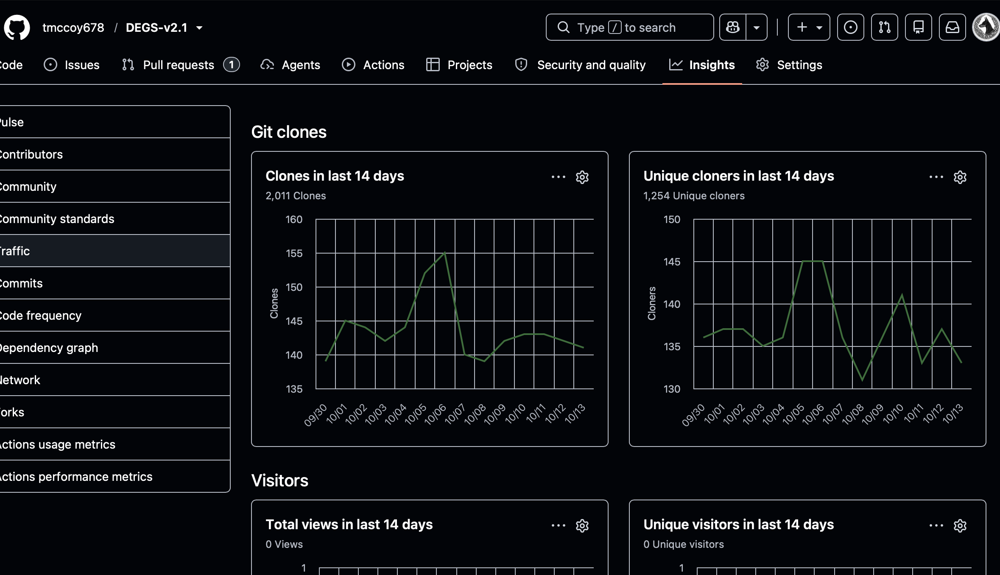
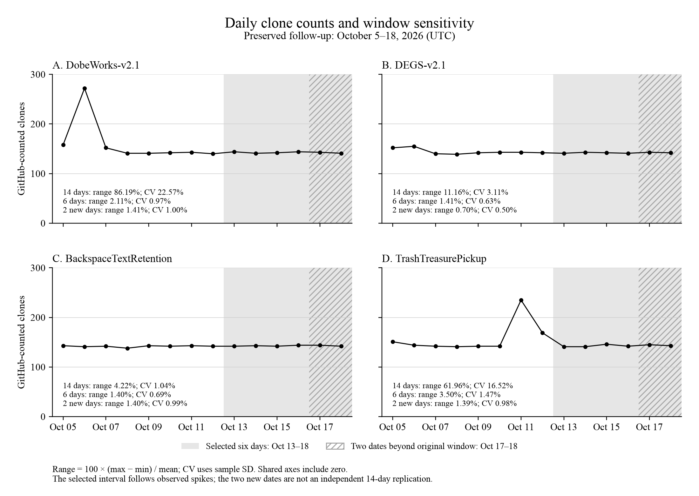
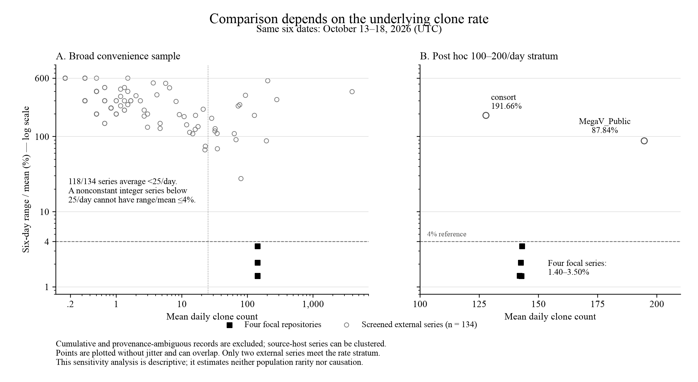

# Who Is Cloning My Repositories? A Case Study of Unusually Regular GitHub Traffic

Taylor McCoy 
October 19, 2026; revised October 20, 2026

## Abstract

GitHub clone counts can suggest an audience that never visits a repository page. I investigated this mismatch across six public repositories under one account. The original October 3–16, 2026 snapshot recorded 8,372 clone events, averaging 598 per day; four repositories contributed 8,271 events. DobeWorks and DEGS recorded no page views in that snapshot. In a later snapshot, the four high-traffic repositories recorded 568–575 combined clones per day during October 13–18, with a sample coefficient of variation of 0.50%. Individual range-to-mean percentages were 1.40%–3.50%. The investigation combined authenticated traffic records, screenshots, public activity histories, and owner-published comparison data. I screened 138 extracted external series, excluding two cumulative counters and two records with provenance or extraction problems. None of the remaining 134 series had a range-to-mean percentage at or below 4%. However, 118 averaged fewer than 25 clones per day, making that threshold unattainable for any nonconstant integer series; only two comparison series averaged 100–200 clones per day. The focal aggregate’s coefficient of variation rose to 7.43% over the full October 5–18 window. Recurring automated collection is a plausible explanation for the recorded plateau. Collector coordination, content-based selection, and push-triggered causation remain unresolved. The contribution is a documented case, a reproducible descriptive reanalysis, and a demonstration of how count rates and window selection affect interpretation of repository traffic.

Keywords: GitHub Traffic, repository telemetry, empirical software engineering, automated collection, case study, reproducibility

## Introduction

The daily shape caught my attention. In my October 14 screenshot, `DEGS-v2.1` had 2,011 clone events, 1,254 unique cloners, and zero page views. Three other repositories soon showed a similar recurring level. `BackspaceTextRetention`, a text-centered investigation of model behavior, was among them. Something about the way these projects were being accessed deserved a closer look.

GitHub reports full clones, excluding subsequent fetches, within a rolling 14-day window. Daily timestamps use UTC. Its published documentation does not define the deduplication unit behind “unique cloner” (GitHub, n.d.-a, n.d.-b). A clone count therefore describes a platform metric whose relationship to readers, organizations, and use requires investigation.

I asked two questions: How regular was the recorded traffic, and how did that regularity compare with other preserved daily series? A further question—who was responsible—motivated the investigation. GitHub’s aggregate endpoints leave that identity unknown.

This is one account-level case containing six repositories. The unusually narrow plateau is the central observation. The study also examines how a short observation period, uneven comparison rates, and incomplete measurement provenance affect explanations of that observation.

## Related Work

Mining repository traces requires attention to what the platform records and how projects enter a sample. Kalliamvakou et al. (2014) describe the diversity and interpretive hazards of GitHub data. Baltes and Ralph (2022) distinguish a sampling frame from the population to which a researcher hopes to generalize. Those concerns apply directly when traffic records are available only because particular owners chose to publish them.

Other owners have reported substantial cloning with little page traffic. NaNoBotCo’s *Uptake* describes 52 repositories over a 14-day window, including repositories with clones and no views, and a large publication-day increase (NaNoBotCo, 2026). McGinnis (2026) compares stars, views, and clones across 63 repositories. These owner reports establish relevant precedents for the broad mismatch. Their interpretations of collectors and audience require the same measurement scrutiny as this study.

A maintainer investigation of GitHub CI clone accounting reports 14 experiments over 22 days, including checkout, authentication, and Pages-build behavior (djdarcy, 2026). Its private testbed and two explicitly contaminated attempts limit independent verification. It illustrates why acquisition paths matter when interpreting the counters. I use GitHub documentation for the documented metric and treat maintainer experiments as bounded empirical reports.

The particular question here is the narrow daily range across several repositories. A search that finds no close match can motivate further work; its sampling frame determines how far that result travels.

## Methods

### Case and observation windows

The six repositories were the account’s complete public set at the original collection. Four high-traffic repositories were identified from their observed totals. `WeatherTicker` and `grok-bridge-writeup` provide within-account contrasts. They differ in subject, age, publication history, and exposure, so the comparison does not isolate any one selection variable.

The original snapshot, collected October 17, covers October 3–16, 2026. The October 19 snapshot covers October 5–18. These windows share 12 days. The October 13–18 interval was selected retrospectively after the last large observed spike. Only October 17–18 add new dates beyond the original window. I retain that six-day description and also report the full available 14 days and the two new dates. No pushes or repositories were created as an experimental intervention.

### Collection and evidence

Authenticated collection used GitHub’s repository clone and view endpoints. The original repository-level totals are preserved in `data/traffic-snapshot-2026-10-17.csv`; the follow-up daily counts and reported window totals are in `data/traffic-snapshot-2026-10-19.csv`. The October 14 screenshots preserve an earlier DEGS window. Public repository activity, Actions histories, configuration checks, and external indexing records supplied contextual evidence.

During revision, the original comparison-search script and extraction output were recovered. The script submitted seven GitHub Code Search queries, requested at most 100 results per query without pagination, and reported 226 distinct candidate file paths. It attempted JSON parsing and CSV parsing; it had no separate JSONL-input parser. It retained complete October 13–18 series with positive means. Repeated dates were resolved by retaining the last encountered record, and identical value vectors within a file were collapsed. These choices limit coverage and can affect which series survive extraction. The recovered script and provenance record are available in `evidence/`.

The preserved extraction contains 138 series. I excluded two cumulative counters, one file under `fixtures/traffic/clones.json` whose observational provenance is uncertain, and one extraction from a CSV containing four repositories per date. In that CSV, the date-only parser retained `SasanLabs/SAFE` counts under the source-host label `SasanLabs/VulnerableApp`. The retained comparison corpus has 134 series hosted in 34 repositories. An archive host can contain records for many measured repositories; 99 retained series come from two hosts. These are clustered convenience observations.

The revision retrieved all 138 retained-source files at their recorded immutable commits and reproduced all 138 historical six-day vectors. This replay verifies the extraction of the retained set. The complete candidate and rejection ledger remains unavailable. The [evidence record](evidence/README.md) distinguishes original client output from these later public-source retrievals.

The original seven subject-related comparisons are retained as a descriptive subset. I added an exploratory rate stratum of 100–200 clones/day around the focal rate of approximately 142. This broad band contains only two external series and was chosen during revision. It supplies a sensitivity check, not a representative matched sample.

### Analysis

For each series, range-to-mean percentage is `100 × (maximum − minimum) / mean`; maximum-deviation percentage is `100 × max(|count − mean|) / mean`; sample coefficient of variation (CV) is `100 × sample standard deviation / mean`. The sample standard deviation uses the `n − 1` denominator. A zero mean makes these relative measures undefined.

The original exploratory search used a 1%–4% interval. The revised analysis also checks all values at or below 4%, so perfectly flat series would count as matches. This does not change the no-match result in the retained corpus. For integer counts, any nonconstant series has a range of at least one; a mean below 25 therefore forces its range-to-mean percentage above 4%. I report the count-rate distribution beside the comparison result.

Repository-level unique-cloner and unique-visitor counts are not summed into an account-wide audience estimate. Cross-repository overlap is unavailable. Clone events and page views are additive event counts. The four-repository clone aggregate is secondary because aggregation can reduce variation.

No significance test or GitHub-wide anomaly probability is reported. The windows are short, the sample is selected, and repository-days and archive sources are dependent. `scripts/analyze.py` reproduces the descriptive calculations from preserved inputs. AI assistance supported collection, extraction, analysis, and revision under my direction; the roles and verification limits are described in the declarations and [MODEL.md](MODEL.md).

## Results

### Recorded scale

Table 1. Original October 3–16 snapshot, collected October 17.

| Repository | Clone events | Unique cloners | Page views | Unique visitors | Mean clones/day |
|---|---:|---:|---:|---:|---:|
| BackspaceTextRetention | 1,991 | 1,216 | 0 | 0 | 142.21 |
| DEGS-v2.1 | 2,009 | 1,262 | 0 | 0 | 143.50 |
| DobeWorks-v2.1 | 2,149 | 1,262 | 0 | 0 | 153.50 |
| TrashTreasurePickup | 2,122 | 1,253 | 1 | 1 | 151.57 |
| grok-bridge-writeup | 98 | 63 | 7 | 1 | 7.00 |
| WeatherTicker | 3 | 3 | 0 | 0 | 0.21 |
| Total | 8,372 | Not additive | 8 | Not additive | 598.00 |

The four high-traffic repositories account for 8,271 events, or 98.79% of the total. The original total divided by 14 is exactly 598. Recovered daily output reproduces all four repository totals; all 48 overlapping repository-days agree with the follow-up snapshot.

Figure 1. Original October 14 screenshot. Its September 30–October 13 window differs from Table 1. Image provenance and hashes are recorded in `figures/README.md`.

### A narrow plateau, with substantial window sensitivity

Table 2. Daily counts in the retrospectively selected October 13–18 interval.

| UTC date | DobeWorks | DEGS | Backspace | Trash/Treasure | Combined |
|---|---:|---:|---:|---:|---:|
| October 13 | 144 | 141 | 142 | 141 | 568 |
| October 14 | 141 | 143 | 143 | 141 | 568 |
| October 15 | 142 | 142 | 142 | 146 | 572 |
| October 16 | 144 | 141 | 144 | 142 | 571 |
| October 17 | 143 | 143 | 144 | 145 | 575 |
| October 18 | 141 | 142 | 142 | 143 | 568 |

The combined mean was 570.33 clones/day, with a 1.23% range-to-mean percentage and a 0.50% sample CV. The four individual range percentages were 1.40%–3.50%; individual CVs were 0.63%–1.47%. WeatherTicker recorded two clones over these dates.

Table 3. Sensitivity to the observation window. Values are range-to-mean percentage / sample CV.

| Series | Full October 5–18 window | Selected October 13–18 interval |
|---|---:|---:|
| DobeWorks | 86.19% / 22.57% | 2.11% / 0.97% |
| DEGS | 11.16% / 3.11% | 1.41% / 0.63% |
| BackspaceTextRetention | 4.22% / 1.04% | 1.40% / 0.69% |
| TrashTreasurePickup | 61.96% / 16.52% | 3.50% / 1.47% |
| Combined | 25.91% / 7.43% | 1.23% / 0.50% |

The plateau is clear in the selected interval. DobeWorks and TrashTreasurePickup are substantially more variable when their earlier spikes remain in the window (Figure 2). The recovered original October 3–16 aggregate has a range-to-mean percentage of 25.90% and a sample CV of 7.40%, close to the full follow-up window. On the two newly observed dates, October 17–18, the combined counts were 575 and 568, with a sample CV of 0.87%. Two dates provide a short continuation of the pattern.

Figure 2. Daily counts and window sensitivity. All panels use the same zero-based vertical scale. Shading marks October 13–18; hatching marks October 17–18, the two dates beyond the original snapshot. Range percentages and sample CVs are calculated separately for each interval. [Vector PDF](figures/reanalysis-window-sensitivity.pdf).

### What the external comparison can tell us

None of the 134 retained external series had a range-to-mean or maximum-deviation percentage at or below 4%. The nearest by range was `dikeckaan/easy-vphone`: 92, 82, 80, 81, 70, and 73 clones, averaging 79.67/day, with a 27.62% range-to-mean percentage and 9.68% sample CV. The seven subject-related comparisons had range percentages of 66.67%–396.69%.

The comparison corpus is dominated by small counts: 118 of 134 series averaged below 25/day, and 76 averaged below one/day. The median mean was 0.67/day. Most nonconstant series in this corpus cannot meet the 4% range threshold because of the integer-count constraint. The large descriptive contrast therefore requires interpretation alongside the count rates (Figure 3).

Only two retained external series averaged 100–200 clones/day. Their means were 194.67 and 127.83/day, with range percentages of 87.84% and 191.66% and sample CVs of 35.29% and 72.02%, respectively. Neither approached the focal six-day plateau. This small stratum leaves its frequency among comparable repositories unknown.

Figure 3. Count rate and relative variation over October 13–18. Open circles represent the 134 screened external series; filled squares represent the four focal repositories. The vertical scale is logarithmic in both panels; the horizontal scale is logarithmic in the broad comparison and linear in the rate stratum. Points can overlap. The 4% line marks the exploratory threshold. [Vector PDF](figures/reanalysis-rate-comparison.pdf).

### Public activity and possible discovery routes

DobeWorks recorded 272 clones and 211 daily unique cloners on October 6, when its public history records nine pushes during a Nova–Grok bridge experiment. TrashTreasurePickup recorded 235 clones on October 11 and 169 on October 12 around merge and workflow activity. Those are date-level associations; the available clone data do not order events within a day.

Three of the four high-traffic repositories had no recorded repository-local Actions runs at the original check. The inventory of owner-side checkouts and external automation is incomplete. The October 19 audit also acquired fresh repository copies; that date is outside the completed daily series analyzed here.

GitHub’s public Events API and ecosyste.ms documentation describe routes for discovering repositories without visiting their pages (GitHub, n.d.-c; ecosyste.ms, n.d.). The original investigation found the focal repositories in the ecosyste.ms index. Its documented archive-based inspection route and the earlier DEGS plateau make it a less direct candidate for explaining these counted clones. The recorded synchronization time supplies one observation of the service’s activity; its complete access history is unavailable.

## Discussion

A recurring automated collection process is a plausible explanation for the plateau. The combination of repeated daily counts and little recorded page traffic motivates that hypothesis. Similar totals could arise from one scheduler, several services, or platform accounting that presents different underlying processes similarly. Daily aggregates cannot distinguish those mechanisms.

WeatherTicker remains informative because it is public, belongs to the same account, and received very little traffic. It demonstrates a within-account difference. Content-based selection is a hypothesis for that difference; publication timing, exposure, and other repository characteristics remain entangled with subject matter.

The same caution applies to the spikes. Their coincidence with public activity makes update-responsive collection worth testing. A prospective study could register its windows and comparison rules before collection, record known owner automation, and preserve repeated API snapshots to examine backfill. Matching public repositories on count rate, age, exposure, and release activity would improve the comparison. No such experiment was conducted here.

The recorded regularity deserves attention. The analysis also shows why the comparison is part of the finding: a low-count series faces different relative-variation constraints, and removing a spike changes the story a window tells. Those observations are useful to researchers interpreting repository traffic as reach, adoption, or evidence of automated access.

### Limitations

This case covers one owner and a short period. Four repositories were selected for attention after their high counts were observed, and the stable six-day interval was chosen retrospectively. The two collection windows overlap heavily. The comparison corpus is a truncated, self-published convenience sample with clustered archive sources and heterogeneous collection practices. Its original parser used permissive date matching and last-record selection; a complete original candidate/rejection ledger has not been recovered. Full October 17 response bodies also remain unavailable; recovered transformed output corroborates the original summaries.

GitHub’s measurement implementation and unique-count deduplication are unavailable for audit. Reporting delay, backfill, incomplete automation inventories, and within-day ordering remain unresolved. The evidence package distinguishes preserved responses, session-recovered outputs, derived tables, and later retrievals of pinned public sources. Those distinctions determine which parts of the investigation can be independently replayed.

## Conclusion

The original snapshot records 8,372 clone events across six repositories. Four account for 98.79% of that total and show a narrow daily plateau during October 13–18. The full-window analysis reveals substantial spike-related variation in two of them, while the rate-stratified comparison exposes how little matched external evidence is available.

I began with a simple question: who is cloning my repositories? The operator remains unknown. What I can now provide is the recorded pattern, the evidence behind it, and a reproducible way to examine its regularity. Recurring automated collection is a plausible explanation to carry into a better controlled follow-up.

## Statements and Declarations

### Author contribution and interests

I own the six focal repositories and developed the projects they contain. I selected the research question, supplied the original screenshots, and directed the investigation and revision. My professional interest in the projects is relevant to interpretation of this account-level case. Career, academic, engineering-review, and cost-estimate materials are maintained separately from the manuscript’s empirical findings.

### AI assistance

OpenAI Codex, using the GPT-6 model family, assisted with authenticated data collection, public-source searches, extraction, descriptive calculations, source-code review, and drafting. The October 20 revision used an assistant signing as Merrin and additional assistant passes for numerical checks, provenance recovery, and writing review. These names identify AI-assisted work. The revision added executable calculations and source checks; I remain responsible for the manuscript. [MODEL.md](MODEL.md) describes these roles and their limits.

### Data and code availability

The study’s data, analysis scripts, evidence provenance, and revision record are maintained in this private repository. External reviewer access requires my authorization. Existing input CSVs remain preserved; corrected results and explicit exclusions are generated separately. [SUPPLEMENTARY_ANALYSIS.md](SUPPLEMENTARY_ANALYSIS.md) documents the files, reproduction commands, and remaining acquisition gaps. Historical snapshots cannot be recreated by asking today’s rolling endpoint for the old dates.

## References

Baltes, S., & Ralph, P. (2022). Sampling in software engineering research: A critical review and guidelines. *Empirical Software Engineering, 27*(4), Article 94. https://doi.org/10.1007/s10664-021-10072-8

djdarcy. (2026, March 25). *How GitHub counts CI clones* [Maintainer experiment; source revision `872b483`]. https://github.com/djdarcy/github-traffic-tracker/blob/872b483a36d4f55b2b4338f46da35b4def37b261/docs/ci-clone-research.md

ecosyste.ms. (n.d.). *How repositories stay up to date* [Service documentation]. https://github.com/ecosyste-ms/repos/blob/main/docs/syncing.md

GitHub. (n.d.-a). *REST API endpoints for repository traffic*. https://docs.github.com/en/rest/metrics/traffic

GitHub. (n.d.-b). *Viewing traffic to a repository*. https://docs.github.com/en/repositories/viewing-activity-and-data-for-your-repository/viewing-traffic-to-a-repository

GitHub. (n.d.-c). *REST API endpoints for events*. https://docs.github.com/en/rest/activity/events

Kalliamvakou, E., Gousios, G., Blincoe, K., Singer, L., German, D. M., & Damian, D. (2014). The promises and perils of mining GitHub. In *Proceedings of the 11th Working Conference on Mining Software Repositories* (pp. 92–101). https://doi.org/10.1145/2597073.2597074

McGinnis, W. (2026, August 13). *Stars, views, and clones across 63 repos* [Owner report]. https://mcginniscommawill.com/posts/2026-08-13-stars-views-and-clones-across-63-repos/

NaNoBotCo. (2026). *Uptake: Publishing for machines that copy* [Owner report; source revision `5eb989e`]. https://github.com/NaNoBotCo/uptake/blob/5eb989e9fd654b6c6d049c600165f525fbe6749c/manual/uptake.md

Comparison-data sources are cited by exact file path and source commit in the preserved CSVs and the evidence manifest. All linked web references were checked during the October 2026 investigation or revision.

## Repository guide

- [Supplementary methods, reproduction, and data corrections](SUPPLEMENTARY_ANALYSIS.md)
- [Revision record](REVISION_NOTES.md)
- [Original and revised figure provenance](figures/README.md)
- [Separate engineering review and judgment-based cost scenarios](READ_ONLY_REVIEW_AND_VALUATION.md)
- [Separate comparable-systems context](COMPARABLE_SYSTEMS_COST_CONTEXT.md)
- [Career and academic context](academic-context/README.md)
