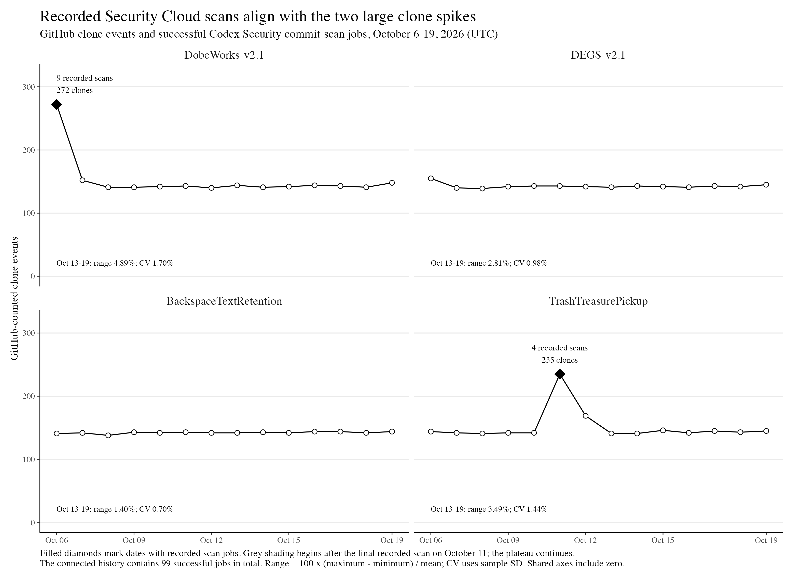
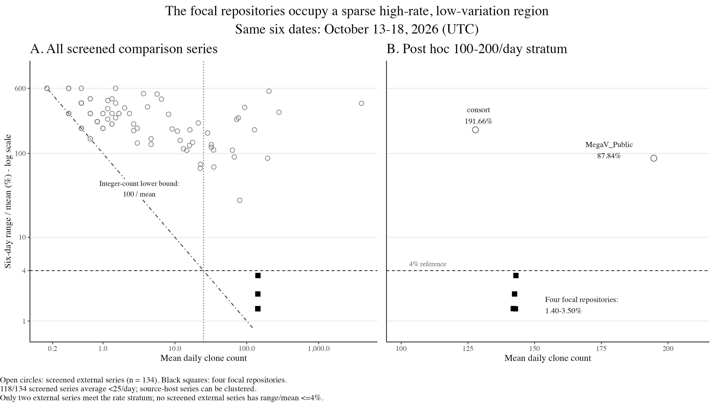

# Who Is Cloning My Repositories? An Exploration of 598 Daily Clone Events Across Six Public Repositories From Exactly 8,372 Recorded Clone Events ÷ 14 Days—With 0 Visitors, 0 Views, No Referrals, Stars, Forks, or External Public Discussion for DobeWorks and DEGS at the Original Snapshot

Taylor McCoy 
October 19, 2026; revised October 20, 2026

> Associated portfolio analyses: [Are My Repositories Worth More Than $10? A read-only engineering review and replacement-cost estimate](READ_ONLY_REVIEW_AND_VALUATION.md) and [Comparable Systems and Cost Context for DobeWorks and DEGS](COMPARABLE_SYSTEMS_COST_CONTEXT.md). These assessments remain separate from the manuscript's empirical clone-traffic claims.

## Abstract

GitHub clone counts can reveal an audience that never visits a repository page. I investigated this mismatch across my six public repositories. The original October 3–16, 2026 snapshot recorded exactly 8,372 clone events, averaging 598 per day; four repositories contributed 8,271 events. DobeWorks and DEGS recorded zero page views and zero visitors in that snapshot. The four high-traffic repositories then recorded 4,004 clone events during October 13–19, averaging 572 per day within a range of 568–582 and a sample coefficient of variation (CV) of 0.90%. The individual repositories varied by only 1.40%–4.89% of their means. After screening 138 extracted external series, I retained 134; none varied by 4% or less over the shared six dates. The 100–200-clones/day comparison stratum contained only two external series, whose range-to-mean percentages were 87.84% and 191.66%, versus 1.40%–3.50% for the four focal repositories. A read-only Codex Security Cloud history supplied the strongest mechanistic lead: the four high-traffic repositories were exactly the four configured for monitoring, and the service recorded 99 successful commit-scan jobs. Nine DobeWorks jobs coincided with its 272-clone October 6 spike; four TrashTreasurePickup jobs coincided with its 235-clone October 11 spike. Those two repository-days ranked first and second among the 56 repository-days in the current traffic window. No recorded job followed October 11, while the 568–582 daily plateau continued through October 19. Codex Security Cloud is the leading candidate mechanism for the spikes and selective repository set. Completed-job history does not account for the continuing floor, and the available interfaces expose neither Cloud repository-acquisition events nor GitHub clone actors.

Keywords: GitHub Traffic, Codex Security Cloud, repository telemetry, empirical software engineering, automated collection, case study, reproducibility

## Introduction

The daily shape caught my attention. In my October 14 screenshot, `DEGS-v2.1` had 2,011 clone events, 1,254 unique cloners, and zero page views. Three other repositories soon showed the same recurring level. `BackspaceTextRetention`, a text-centered investigation rather than a software tool, was among them. Across October 13–19, those four repositories each received almost exactly 143 clones per day. Their combined count stayed between 568 and 582 for seven consecutive days.

The strongest continuation appeared on the final two observed dates. The four-repository daily unique-cloner sum stayed fixed at 551 on October 18 and 19, while clone events increased from 568 to 582. DobeWorks and DEGS together recorded exactly 2,000 clone events and a summed 1,931 daily unique-cloner observations over the seven-day continuation. This repeated structure is the empirical center of the study.

The investigation now has a concrete candidate mechanism. The four repositories with the recurring high traffic are exactly the four repositories displayed as monitored in Codex Security Cloud. Its read-only history contains 99 successful commit-scan jobs across those repositories. Recorded jobs align with the two largest visible spikes, while the recurring floor continues after the final recorded job. This exact repository-set match and temporal alignment make Codex Security Cloud central to the causal investigation.

GitHub reports full clones, excluding subsequent fetches, within a rolling 14-day window. Daily timestamps use UTC. Its published documentation does not define the deduplication unit behind “unique cloner” (GitHub, n.d.-a, n.d.-b). A clone count therefore describes a platform metric whose relationship to readers, organizations, and use requires investigation.

I asked two questions: How regular was the recorded traffic, and how did that regularity compare with other preserved daily series? A further question—who was responsible—motivated the investigation. GitHub’s aggregate endpoints leave that identity unknown.

This is one account-level case containing six repositories. WeatherTicker provides the sharpest internal contrast: it is public and belongs to the same account, yet it recorded five clones in the current 14-day response while the four focal repositories recorded 8,245. The study examines this selective plateau alongside short observation windows, uneven comparison rates, and incomplete measurement provenance.

## Related Work

Mining repository traces requires attention to what the platform records and how projects enter a sample. Kalliamvakou et al. (2014) describe the diversity and interpretive hazards of GitHub data. Baltes and Ralph (2022) distinguish a sampling frame from the population to which a researcher hopes to generalize. Those concerns apply directly when traffic records are available only because particular owners chose to publish them.

Other owners have reported substantial cloning with little page traffic. NaNoBotCo’s *Uptake* describes 52 repositories over a 14-day window, including repositories with clones and no views, and a large publication-day increase (NaNoBotCo, 2026). McGinnis (2026) compares stars, views, and clones across 63 repositories. These owner reports establish relevant precedents for the broad mismatch. Their interpretations of collectors and audience require the same measurement scrutiny as this study.

A maintainer investigation of GitHub CI clone accounting reports 14 experiments over 22 days, including checkout, authentication, and Pages-build behavior (djdarcy, 2026). Its private testbed and two explicitly contaminated attempts limit independent verification. It illustrates why acquisition paths matter when interpreting the counters. I use GitHub documentation for the documented metric and treat maintainer experiments as bounded empirical reports.

The particular question here is the narrow daily range across several repositories. A search that finds no close match can motivate further work; its sampling frame determines how far that result travels.

## Methods

### Case and observation windows

The six repositories were the account’s complete public set at the original collection. Four high-traffic repositories were identified from their observed totals. `WeatherTicker` and `grok-bridge-writeup` provide within-account contrasts. Subject, age, publication history, and exposure remain confounded in this comparison.

The original snapshot, collected October 17, covers October 3–16, 2026. The October 19 snapshot covers October 5–18, and the October 20 response covers October 6–19. The original and current windows share 11 days. I retain October 13–18 as the shared six-day interval for the external comparison and report October 13–19 as the seven-day continuation. October 17–19 are the three dates beyond the original window. These intervals were selected retrospectively after the observed spikes. No pushes or repositories were created as an experimental intervention.

### Data collection and evidence

Authenticated collection used GitHub’s clone, view, popular-referrer, and popular-path endpoints. The original repository-level totals are preserved in `data/traffic-snapshot-2026-10-17.csv`; the first follow-up is in `data/traffic-snapshot-2026-10-19.csv`. The complete October 20 response is preserved at `evidence/live/2026-10-20/github-traffic-response.json`, and the R workflow derives `data/traffic-snapshot-2026-10-20.csv` from it. The response was captured at 2026-10-20 14:30:13 UTC and contains no authentication headers or credentials. The October 14 screenshots preserve an earlier DEGS window. Public repository activity, Actions histories, configuration checks, and external indexing records supplied contextual evidence.

On October 20, I queried my connected Codex Security Cloud workspace through its read-only scan-history interface. I reduced the response to repository, UTC date, scan count, success count, and first and last start times, omitting account identifiers, commit identifiers, generated threat models, and email addresses. The resulting table is `data/codex-security-scan-history-summary-2026-10-20.csv`; its capture and reduction record is preserved in `evidence/live/2026-10-20/codex-security-scan-history-summary.json`. The dashboard captures supplied for this check contain account information and are not republished.

During revision, the original comparison-search script and extraction output were recovered. The script submitted seven GitHub Code Search queries, requested at most 100 results per query without pagination, and reported 226 distinct candidate file paths. It attempted JSON parsing and CSV parsing; it had no separate JSONL-input parser. It retained complete October 13–18 series with positive means. Repeated dates were resolved by retaining the last encountered record, and identical value vectors within a file were collapsed. These choices limit coverage and can affect which series survive extraction. The recovered script and provenance record are available in `evidence/`.

The preserved extraction contains 138 series. I excluded two cumulative counters, one file under `fixtures/traffic/clones.json` whose observational provenance is uncertain, and one extraction from a CSV containing four repositories per date. In that CSV, the date-only parser retained `SasanLabs/SAFE` counts under the source-host label `SasanLabs/VulnerableApp`. The retained comparison corpus has 134 series hosted in 34 repositories. An archive host can contain records for many measured repositories; 99 retained series come from two hosts. These are clustered convenience observations.

The revision retrieved all 138 retained-source files at their recorded immutable commits and reproduced all 138 historical six-day vectors. This replay verifies the extraction of the retained set. The complete candidate and rejection ledger remains unavailable. The [evidence record](evidence/README.md) distinguishes original client output from these later public-source retrievals.

The original seven subject-related comparisons are retained as a descriptive subset. I added an exploratory rate stratum of 100–200 clones/day around the focal rate of approximately 142. This broad band was chosen during revision and contains only two external series. It supplies a small post hoc sensitivity check.

### Data analysis

For each series, range-to-mean percentage is `100 × (maximum − minimum) / mean`; maximum-deviation percentage is `100 × max(|count − mean|) / mean`; sample coefficient of variation (CV) is `100 × sample standard deviation / mean`. The sample standard deviation uses the `n − 1` denominator. A zero mean makes these relative measures undefined.

The original exploratory search used a 1%–4% interval. The revised analysis also checks all values at or below 4%, so perfectly flat series would count as matches. Both definitions return zero matches in the retained corpus. For integer counts, any nonconstant series has a range of at least one; a mean below 25 therefore forces its range-to-mean percentage above 4%. I report the count-rate distribution beside the comparison result.

Repository-level unique-cloner and unique-visitor counts are not summed into an account-wide audience estimate. Cross-repository overlap is unavailable. Clone events and page views are additive event counts. The four-repository clone aggregate is secondary because aggregation can reduce variation.

No significance test or GitHub-wide anomaly probability is reported. The windows are short, the sample is selected, and repository-days and archive sources are dependent. `scripts/analyze_and_plot.R` is hand-written R code that reads the preserved raw response and scan-history summary, produces the current derived tables, calculates every reported current-window statistic, and renders Figures 2–3 as PNG and vector PDF files. `scripts/analyze.py` independently reproduces the earlier preserved-window analysis. AI assistance supported collection, extraction, analysis, and revision under my direction; the roles and verification limits are described in the declarations and [MODEL.md](MODEL.md).

## Results

### Recorded scale

Table 1. Original October 3–16 snapshot, collected October 17.

| Repository | Clone events | Unique cloners | Page views | Unique visitors | Mean clones/day |
|---|---:|---:|---:|---:|---:|
| BackspaceTextRetention | 1,991 | 1,216 | 0 | 0 | 142.21 |
| DEGS-v2.1 | 2,009 | 1,262 | 0 | 0 | 143.50 |
| DobeWorks-v2.1 | 2,149 | 1,262 | 0 | 0 | 153.50 |
| TrashTreasurePickup | 2,122 | 1,253 | 1 | 1 | 151.57 |
| grok-bridge-writeup | 98 | 63 | 7 | 1 | 7.00 |
| WeatherTicker | 3 | 3 | 0 | 0 | 0.21 |
| Total | 8,372 | Not additive | 8 | Not additive | 598.00 |

The four high-traffic repositories account for 8,271 events, or 98.79% of the total. The original total divided by 14 is exactly 598. Recovered daily output reproduces all four repository totals; all 48 overlapping repository-days agree with the follow-up snapshot.

At the original audit, DobeWorks and DEGS also had empty popular-referrer results, zero GitHub stars, zero forks, and no outside public discussion found through exact-name and exact-URL searches. Those observations define the zero-engagement language in the title.

Figure 1. Original October 14 screenshot. Its September 30–October 13 window differs from Table 1. Image provenance and hashes are recorded in `figures/README.md`.

### A narrow plateau, with scan-aligned spikes

Table 2. Daily counts in the October 13–19 continuation interval.

| UTC date | DobeWorks | DEGS | Backspace | Trash/Treasure | Combined |
|---|---:|---:|---:|---:|---:|
| October 13 | 144 | 141 | 142 | 141 | 568 |
| October 14 | 141 | 143 | 143 | 141 | 568 |
| October 15 | 142 | 142 | 142 | 146 | 572 |
| October 16 | 144 | 141 | 144 | 142 | 571 |
| October 17 | 143 | 143 | 144 | 145 | 575 |
| October 18 | 141 | 142 | 142 | 143 | 568 |
| October 19 | 148 | 145 | 144 | 145 | 582 |

The combined mean was 572 clones/day, with a 2.45% range-to-mean percentage and a 0.90% sample CV. The four individual range percentages were 1.40%–4.89%; individual CVs were 0.70%–1.70%. DobeWorks and DEGS together recorded exactly 2,000 clone events over these seven days. WeatherTicker recorded four clones over the same dates.

Table 3. Sensitivity to the observation window. Values are range-to-mean percentage / sample CV.

| Series | Current October 6–19 window | October 13–19 continuation |
|---|---:|---:|
| DobeWorks | 86.60% / 22.68% | 4.89% / 1.70% |
| DEGS | 11.19% / 2.64% | 2.81% / 0.98% |
| BackspaceTextRetention | 4.22% / 1.08% | 1.40% / 0.70% |
| TrashTreasurePickup | 62.13% / 16.61% | 3.49% / 1.44% |
| Combined | 25.98% / 7.43% | 2.45% / 0.90% |

The plateau continues through October 19. DobeWorks and TrashTreasurePickup are substantially more variable when their earlier spikes remain in the window (Figure 2). The recovered original October 3–16 aggregate has a range-to-mean percentage of 25.90% and a sample CV of 7.40%, close to the current full-window result. Across the three newly observed dates, October 17–19, the combined counts were 575, 568, and 582, with a sample CV of 1.22%.

Figure 2. Clone traffic and Codex Security scan alignment, generated in R. Filled diamonds mark UTC dates with recorded successful commit-scan jobs. Those two repository-days rank first and second among the 56 plotted repository-days. Grey shading begins after the final recorded scan on October 11. All panels use the same zero-based vertical scale; the displayed range percentages and sample CVs describe the October 13–19 continuation. [Vector PDF](figures/r-window-sensitivity-2026-10-20.pdf).

### Codex Security Cloud as a candidate mechanism

The connected history contains 99 successful commit-scan jobs: 81 on September 28, two on October 2, three on October 5, nine on October 6, and four on October 11. The September 28 batch comprises 39 TrashTreasurePickup jobs, 25 DobeWorks jobs, 11 DEGS jobs, and six BackspaceTextRetention jobs. These four repositories are exactly the four repositories displayed as monitored in the supplied Codex Security Cloud dashboard captures. WeatherTicker and the other low-traffic public repositories are not displayed as monitored.

Table 4. Codex Security scan history and clone alignment. The no-scan median uses October 6–19 dates without a recorded job for that repository.

| Repository | Recorded scan jobs | Last recorded scan (UTC) | Jobs in current window | No-scan median clones | Peak date | Peak clones | Peak rank of 56 | Jobs on peak date | Peak excess over no-scan median |
|---|---:|---|---:|---:|---|---:|---:|---:|---:|
| DobeWorks-v2.1 | 36 | October 6, 17:35 | 9 | 142 | October 6 | 272 | 1 | 9 | +130 |
| DEGS-v2.1 | 12 | October 5, 23:21 | 0 | 142 | October 6 | 155 | 4 | 0 | +13 |
| BackspaceTextRetention | 6 | September 28, 22:48 | 0 | 142 | October 16 | 144 | 11 | 0 | +2 |
| TrashTreasurePickup | 45 | October 11, 20:29 | 4 | 142 | October 11 | 235 | 2 | 4 | +93 |

The two repository-days with recorded scan jobs are exactly the two largest of the 56 repository-days in the October 6–19 window. DobeWorks had nine jobs and 272 clones on October 6, 130 above its no-scan-day median. TrashTreasurePickup had four jobs and 235 clones on October 11, 93 above its no-scan-day median. Pushes and completed Security scans can share a date, so this association identifies Codex Security as a testable mechanism rather than allocating individual clone events.

No recorded scan job followed October 11, yet the four-repository aggregate remained between 568 and 582 from October 13 through 19. The dashboard still displayed all four configurations as Monitoring, while the connected usage state reported unavailable scan funding and `credits_exhausted`. The read-only interface does not report whether repository acquisition or other background work continued after the completed jobs stopped. The exact monitored-set match makes Codex Security Cloud the leading candidate mechanism for the selective plateau, while the continuing floor remains unattributed.

OpenAI describes the initial Codex Security process as building a threat model and scanning repository history, followed by faster scans of new code (OpenAI, 2026). GitHub documents that traffic counts full clones rather than fetches and that a GitHub App with repository-content access can perform an authenticated Git clone (GitHub, n.d.-b, n.d.-d). Neither source documents the acquisition method used by the Cloud backend. GitHub’s traffic response contains no actor labels.

### What the external comparison can tell us

None of the 134 retained external series had a range-to-mean or maximum-deviation percentage at or below 4%. The nearest by range was `dikeckaan/easy-vphone`: 92, 82, 80, 81, 70, and 73 clones, averaging 79.67/day, with a 27.62% range-to-mean percentage and 9.68% sample CV. The seven subject-related comparisons had range percentages of 66.67%–396.69%.

The comparison corpus is dominated by small counts: 118 of 134 series averaged below 25/day, and 76 averaged below one/day. The median mean was 0.67/day. Most nonconstant series in this corpus cannot meet the 4% range threshold because of the integer-count constraint. The large descriptive contrast therefore requires interpretation alongside the count rates (Figure 3).

Only two retained external series averaged 100–200 clones/day. Their means were 194.67 and 127.83/day, with range percentages of 87.84% and 191.66% and sample CVs of 35.29% and 72.02%, respectively. Neither approached the focal six-day plateau. This small stratum leaves its frequency among comparable repositories unknown.

Table 5. The focal repositories, two rate peers, and the nearest external series by variation over October 13–18.

| Repository or group | Subject | Mean clones/day | Range ÷ mean | Sample CV |
|---|---|---:|---:|---:|
| Four focal repositories | AI/model behavior, evidence governance, governed agent work, and context transfer | 142.00–143.00 | 1.40%–3.50% | 0.63%–1.47% |
| [`Romaxa55/MegaV_Public`](https://github.com/Romaxa55/MegaV_Public) | Cross-platform privacy and VPN client | 194.67 | 87.84% | 35.29% |
| [`databricks-solutions/consort`](https://github.com/databricks-solutions/consort) | Coordinated AI coding agents with specification-first and test-driven workflow | 127.83 | 191.66% | 72.02% |
| [`dikeckaan/easy-vphone`](https://github.com/dikeckaan/easy-vphone) | Native macOS virtual-phone manager and IPA library | 79.67 | 27.62% | 9.68% |

Figure 3. Count rate and relative variation over October 13–18, generated in R. Open circles represent the 134 screened external series; filled squares represent the four focal repositories. The dot-dash curve is the mathematical lower bound `100 / mean` for a nonconstant integer-count series. The vertical scale is logarithmic in both panels; the horizontal scale is logarithmic in the broad comparison and linear in the rate stratum. Points can overlap. The 4% line marks the exploratory threshold. [Vector PDF](figures/r-rate-comparison-2026-10-20.pdf).

The repository-level daily unique-cloner sums ranged from 534 to 559 during the seven-day continuation, with a 1.41% sample CV. Cross-repository overlap is unavailable, so these values remain repository-level daily observations rather than an account-wide audience estimate. On October 18 and 19, the sum was identical at 551 while clone events rose by 14. A separate figure was omitted because this result is clearer as an exact textual comparison and the undeduplicated sum limits visual interpretation.

### Within-account subject and repository form

Table 6. Current October 6–19 authenticated response and primary subject.

| Repository | Primary subject and form | Clone events | Window unique cloners | Views |
|---|---|---:|---:|---:|
| BackspaceTextRetention | Deleted-text retention in an AI interaction; Python investigation and evidence | 1,992 | 1,196 | 0 |
| DEGS-v2.1 | Evidence-based engineering assurance; Python policy gate, schemas, fixtures, and documentation | 2,001 | 1,245 | 3 |
| DobeWorks-v2.1 | Governed agent execution and observation; Python cores, evidence, policy, and benchmarks | 2,134 | 1,258 | 0 |
| TrashTreasurePickup | Inspectable context transfer between AI tasks; Python tool and verification material | 2,118 | 1,227 | 1 |
| grok-bridge-writeup | AI bridge experiment; small documentary repository | 101 | 66 | 7 |
| WeatherTicker | Privacy-conscious weather ticker; PowerShell desktop utility | 5 | 5 | 0 |

The four high-traffic repositories share a broad concern with AI systems, evidence, governed behavior, or context transfer, and all contain executable Python plus substantial supporting material. The smaller Grok writeup also concerns AI yet received far less clone traffic. WeatherTicker is the clearest subject-and-form contrast: a conventional PowerShell utility with five clones. The observed selection is narrower than public visibility and broader than a simple AI/non-AI split.

### Account-age context

My GitHub account was created August 10, 2026. The bounded account comparison retained 32 public accounts from the first 50 ascending search results; all 32 were created August 9 because that result limit truncated the nominal August 9–11 query. Their median profile had five public repositories and zero followers, stars, and forks in the inspected fields. Twenty-seven had zero stars and 31 had zero forks. My account's public engagement was ordinary for this narrow young-account cohort. Clone traffic remains unavailable for those accounts because GitHub restricts repository traffic to users with push access.

### Public activity and possible discovery routes

DobeWorks recorded 272 clones and 211 daily unique cloners on October 6, when its public history records nine pushes during a Nova–Grok bridge experiment and Codex Security recorded nine successful commit-scan jobs. TrashTreasurePickup recorded 235 clones on October 11, when Codex Security recorded four successful jobs, followed by 169 clones on October 12. The daily traffic endpoint cannot resolve within-day order.

#### What happened on October 6

The public DobeWorks history records a rapid bridge experiment involving Nova and Grok (McCoy, 2026). A message lane appeared late on October 5. On October 6, the project added a Gmail confirmation, a three-leg read-only reconnaissance record, and a small webhook receiver for `bridge.dobeworks.com`; the webhook receiver was removed minutes later. The bridge files were retired, the repository was restored, and `BRIDGE.md` remained as the public record. A VM associated with the experiment polled the message lane approximately every 15 seconds.

Nine pushes occurred that day. The lasting change relative to the preceding public-usability merge was 63 inserted lines: a 38-line bridge note, four citation lines, and 21 lines adding an explicit JSON nesting-depth defense. GitHub recorded 272 DobeWorks clones and 211 daily unique cloners, almost twice its recurring floor. The new `grok-bridge-writeup` repository recorded 69 clones and 43 daily unique cloners on October 6. The alignment makes push- or content-responsive collection a strong target for prospective testing.

Three of the four high-traffic repositories had no recorded repository-local Actions runs at the original check. Codex Security Cloud now supplies a documented external automation source for all four. A separate October 19 read-only architecture review acquired fresh repository copies; the daily aggregate cannot isolate its contribution.

GitHub’s public Events API and ecosyste.ms documentation describe routes for discovering repositories without visiting their pages (GitHub, n.d.-c; ecosyste.ms, n.d.). The original investigation found the focal repositories in the ecosyste.ms index. Its documented archive-based inspection route and the earlier DEGS plateau make it a less direct candidate for explaining these counted clones. The recorded synchronization time supplies one observation of the service’s activity; its complete access history is unavailable.

## Discussion

Codex Security Cloud is the leading candidate mechanism. Its monitored repository set matches the high-traffic set exactly, and the only two repository-days with recorded jobs are the two largest counts in the 56-day-by-repository window. The continuing plateau after its last recorded job remains unexplained because the available interfaces contain no backend repository-acquisition log.

GitHub traffic reporting had a documented public-repository interruption shortly before this study. Owners reported daily clone and view series stopping after September 23, and a GitHub staff response on September 30 stated that a fix had shipped (GitHub Community, 2026). The focal plateau is visible from September 30 and persists through October 19. The interruption makes pre-fix and immediately backfilled values less secure for temporal inference; the sustained October 13–19 regularity occurs nearly two weeks after the reported fix.

WeatherTicker remains informative because it is public, belongs to the same account, received very little traffic, and was not displayed as monitored in Codex Security Cloud. That monitoring difference now supplies a more concrete explanation for its contrast with the four focal repositories than subject matter alone.

The cleanest prospective test would preregister a quiet observation interval, preserve hourly traffic responses, and change monitoring for one repository while leaving the other focal repositories unchanged. A second, stronger test would enable monitoring for a previously unmonitored low-traffic repository such as WeatherTicker and examine whether its clone series moves toward the recurring level. Either intervention should be separated from pushes and other owner automation. No monitoring configuration was changed for this read-only investigation.

The recorded regularity deserves attention. The analysis also shows why the comparison is part of the finding: a low-count series faces different relative-variation constraints, and removing a spike changes the story a window tells. Those observations are useful to researchers interpreting repository traffic as reach, adoption, or evidence of automated access.

### Limitations

This case covers one owner and a short period. Four repositories were selected for attention after their high counts were observed, and the stable interval was chosen retrospectively. The collection windows overlap heavily. The comparison corpus is a truncated, self-published convenience sample with clustered archive sources and heterogeneous collection practices. Its original parser used permissive date matching and last-record selection; a complete original candidate/rejection ledger has not been recovered. Full October 17 response bodies also remain unavailable; recovered transformed output corroborates the original summaries. GitHub’s September traffic interruption adds a platform-level measurement event near the start of the available history.

GitHub’s measurement implementation and unique-count deduplication are unavailable for audit. Codex Security exposes completed scan jobs but not its repository-acquisition logs, worker count, network identities, or background monitoring operations. Reporting delay, backfill, incomplete automation inventories, and within-day ordering remain unresolved. The evidence package distinguishes preserved responses, session-recovered outputs, derived tables, and later retrievals of pinned public sources. Those distinctions determine which parts of the investigation can be independently replayed.

The title's “no external public discussion” observation is bounded to the exact-name and exact-URL searches performed during the original audit. Full search-result pages from that audit were not preserved.

## Conclusion

The original snapshot records exactly 8,372 clone events across six repositories, or 598 per day. Four account for 98.79% of that total and continue at 568–582 combined clones per day through October 19. DobeWorks and DEGS contribute exactly 2,000 events during that seven-day continuation. The full-window analysis retains the earlier spikes, while the rate-stratified comparison shows that matched external evidence is scarce and dramatically more variable in the two available rate peers.

I began with a simple question: who is cloning my repositories? Codex Security Cloud is now the strongest candidate mechanism. It is directly connected to exactly the four high-traffic repositories, recorded 99 successful commit scans, and aligns with the two largest repository-day counts in the current window. Its completed-job history ends before the continuing plateau. A controlled monitoring intervention can test whether the recurring floor responds to Cloud configuration.

## Statements and Declarations

### Author contribution and interests

I own the six focal repositories and developed the projects they contain. I selected the research question, supplied the original screenshots, and directed the investigation and revision. My professional interest in the projects is relevant to interpretation of this account-level case. Career, academic, engineering-review, and cost-estimate materials are maintained separately from the manuscript’s empirical findings.

### AI assistance

OpenAI Codex, using the GPT-6 model family, assisted with authenticated data collection, public-source searches, extraction, descriptive calculations, source-code review, drafting, and figure production. The October 20 methodological revision began with an assistant signing as Merrin; Cairn collected the October 20 continuation response and wrote and ran the R analysis and plotting workflow. These working names identify AI-assisted work. The revision added executable calculations and source checks; I remain responsible for the manuscript. [MODEL.md](MODEL.md) describes these roles and their limits.

### Data and code availability

The study’s data, analysis scripts, evidence provenance, and revision record are maintained in this private repository. External reviewer access requires my authorization. Existing input CSVs remain preserved; corrected results and explicit exclusions are generated separately. [SUPPLEMENTARY_ANALYSIS.md](SUPPLEMENTARY_ANALYSIS.md) documents the files, reproduction commands, and remaining acquisition gaps. Historical snapshots cannot be recreated by asking today’s rolling endpoint for the old dates.

## References

Baltes, S., & Ralph, P. (2022). Sampling in software engineering research: A critical review and guidelines. *Empirical Software Engineering, 27*(4), Article 94. https://doi.org/10.1007/s10664-021-10072-8

djdarcy. (2026, March 25). *How GitHub counts CI clones* [Maintainer experiment; source revision `872b483`]. https://github.com/djdarcy/github-traffic-tracker/blob/872b483a36d4f55b2b4338f46da35b4def37b261/docs/ci-clone-research.md

ecosyste.ms. (n.d.). *How repositories stay up to date* [Service documentation]. https://github.com/ecosyste-ms/repos/blob/main/docs/syncing.md

GitHub. (n.d.-a). *REST API endpoints for repository traffic*. https://docs.github.com/en/rest/metrics/traffic

GitHub. (n.d.-b). *Viewing traffic to a repository*. https://docs.github.com/en/repositories/viewing-activity-and-data-for-your-repository/viewing-traffic-to-a-repository

GitHub. (n.d.-c). *REST API endpoints for events*. https://docs.github.com/en/rest/activity/events

GitHub. (n.d.-d). *Authenticating as a GitHub App installation*. https://docs.github.com/en/apps/creating-github-apps/authenticating-with-a-github-app/authenticating-as-a-github-app-installation

GitHub Community. (2026, September 30). *Traffic statistics for my public repositories appear to have stopped updating after 2026-09-23* [Community discussion; GitHub staff answer]. https://github.com/orgs/community/discussions/208852

Kalliamvakou, E., Gousios, G., Blincoe, K., Singer, L., German, D. M., & Damian, D. (2014). The promises and perils of mining GitHub. In *Proceedings of the 11th Working Conference on Mining Software Repositories* (pp. 92–101). https://doi.org/10.1145/2597073.2597074

McGinnis, W. (2026, August 13). *Stars, views, and clones across 63 repos* [Owner report]. https://mcginniscommawill.com/posts/2026-08-13-stars-views-and-clones-across-63-repos/

McCoy, T. (2026). *DobeWorks v2.1* [Computer software]. GitHub. https://github.com/tmccoy678/DobeWorks-v2.1

NaNoBotCo. (2026). *Uptake: Publishing for machines that copy* [Owner report; source revision `5eb989e`]. https://github.com/NaNoBotCo/uptake/blob/5eb989e9fd654b6c6d049c600165f525fbe6749c/manual/uptake.md

OpenAI. (2026). *Codex Security*. https://help.openai.com/en/articles/20001107-codex-security

Comparison-data sources are cited by exact file path and source commit in the preserved CSVs and the evidence manifest. All linked web references were checked during the October 2026 investigation or revision.

## Repository guide

- [Supplementary methods, reproduction, and data corrections](SUPPLEMENTARY_ANALYSIS.md)
- [RStudio project](Who-is-cloning-my-repos.Rproj) and [hand-written R analysis and figure code](scripts/analyze_and_plot.R)
- [Revision record](REVISION_NOTES.md)
- [Original and revised figure provenance](figures/README.md)
- [Separate engineering review and judgment-based cost scenarios](READ_ONLY_REVIEW_AND_VALUATION.md)
- [Separate comparable-systems context](COMPARABLE_SYSTEMS_COST_CONTEXT.md)
- [Career and academic context](academic-context/README.md)
